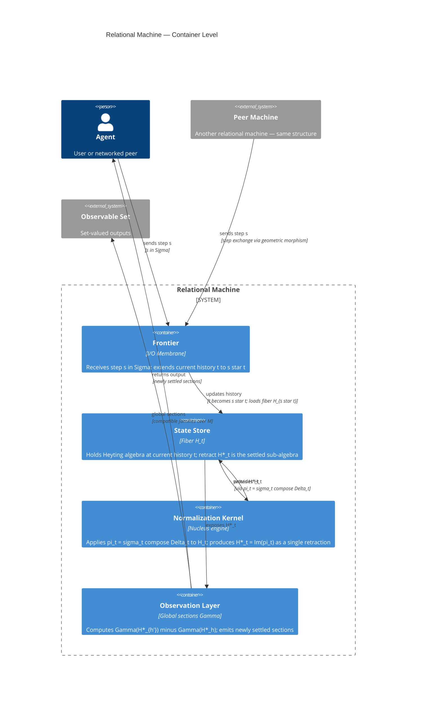

# Relational Machine — C4 System Architecture

C4 notation. Current level: Container.
Texture using `spec/skills/texture-diagrams.md`.

---

## Correspondence

| System node | Math node | Notes |
|---|---|---|
| Frontier | M | The star operation IS extending history — Frontier executes it |
| State Store | H_t | The fiber at current t is what the State Store holds |
| Normalization Kernel | H_star_t + pi_t | pi_t = sigma compose Delta is what the Kernel computes |
| Observation Layer | Gamma | The limit construction is what the Observation Layer runs |

---

## Open texture points

- Frontier: needs Component-level detail — step receiver vs history updater
- State Store: needs Component-level detail — fiber loader vs H* retract
- Normalization Kernel: needs Component-level detail — sigma pass, Delta pass, convergence check
- Observation Layer: needs Component-level detail — diff computation vs section emitter
- Peer Machine connection: geometric morphism between two machines not yet a Container

---

## Specced
