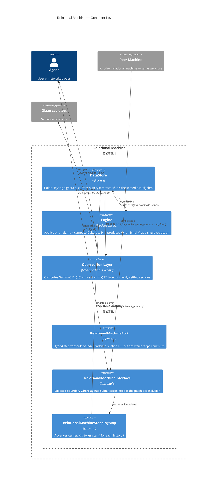

# Relational Machine — C4 System Architecture

**Note:** This is a [DistributedRelationalMachineRuntime](distributed-relational-machine-runtime.md) diagram — it describes the concrete system with containers, agents, and MCP, not the abstract RelationalMachine.

C4 notation.
Current level: Container.
Texture using `spec/skills/texture-diagrams.md`.

---

## Correspondence

| System node | Math node | Notes |
|---|---|---|
| RelationalMachinePort | (Σ, I) | The step vocabulary and independence relation |
| RelationalMachineInterface | ι : U → T | The patch site foot — where external steps enter T |
| RelationalMachineSteppingMap | γ_t : X(t) → X(s★t) | The coalgebra map advancing carrier state by one step |
| DataStore | H_t | The fiber at current t is what the DataStore holds |
| Engine | H_star_t + pi_t | pi_t = sigma compose Delta is what the Engine computes |
| Observation Layer | Gamma | The limit construction is what the Observation Layer runs |

---

## Open texture points

- Input Boundary: Port/Interface/SteppingMap decomposition is done at Container level; Component-level detail for each still needed
- DataStore: needs Component-level detail — fiber loader vs H* retract
- Engine: needs Component-level detail — sigma pass, Delta pass, convergence check
- Observation Layer: needs Component-level detail — diff computation vs section emitter
- Peer Machine connection: geometric morphism between two machines not yet a Container

---

## Specced
