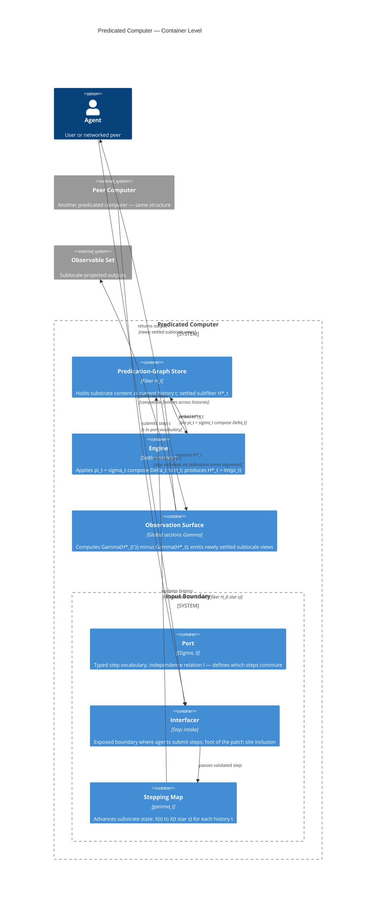

# Architecture diagrams: the predicated computer at two levels

The predicated computer's [four-component anatomy](teaching/explanations/substrate-anatomy-as-four-components.md) admits two complementary diagrammatic readings: a *deployment-time* C4 container diagram showing the runtime topology, and a *math-structure* class diagram showing the underlying categorical objects. The two diagrams describe the same substrate from different vantages — the C4 view answers "what runs where?" and the math view answers "what is the algebraic structure?" Reading them together is one of the more efficient ways to verify that the substrate's runtime commitments correspond directly to the substrate's mathematical structure, with no slack.

The diagrams below are the substrate's canonical illustrations. Specific implementations (per [filesystem-backed-substrate](filesystem-backed-substrate.md), [distributed-predicated-runtime](distributed-predicated-runtime.md), and others) are realizations of these structures with concrete deployment vehicles.

## C4 container diagram: the runtime topology

The container-level diagram shows the predicated computer as a system boundary containing four components, with external actors (agents, peer machines) and an external observable set:



### C4 correspondence table

Each container in the diagram corresponds to a substrate-level concept:

| Container | Substrate concept | Brief |
|---|---|---|
| Port | [port](teaching/explanations/port.md) | Typed step vocabulary $(\Sigma, I)$ — what messages are admissible and which pairs commute |
| Interfacer | [interfacer](teaching/explanations/interfacer.md) | The boundary's discipline for translating external bytes to/from port-typed messages |
| Stepping Map | [stepping](teaching/explanations/stepping.md) | The advance-by-one-step discipline; the coalgebra map $\gamma_t : X(t) \to X(t \cdot s)$ |
| Predication-Graph Store | [predication-graph store](../objects/predication-graph-store.md) | The substrate's queryable representation; the fiber $H_t$ at current history |
| Engine | [engine](teaching/explanations/engine.md) | The settle operator; the joint projection $\pi_t = \sigma_t \circ \Delta_t$ retracting $H_t$ onto $H^*_t$ |
| Observation Surface | [sublocale-as-application](teaching/explanations/sublocale-as-application.md) | The substrate's read-side discipline; global sections $\Gamma$ over the indexed family |

The four-component anatomy decomposes naturally into the C4 containers above. An engineer reading the diagram knows exactly where each substrate concern is hosted; an auditor knows where to look for each substrate operation's witness chain.

## Math class diagram: the categorical structure

The math-side diagram shows the same structure at the categorical level — the objects and morphisms that the substrate's algebra commits to:

```mermaid
classDiagram
    direction LR

    class M {
        <<history monoid — substrate time>>
        M(Sigma,I): congruence classes of Sigma* under independence
        I subset Sigma x Sigma: symmetric, irreflexive
        op star: M x M to M — concatenation of classes
        unit: epsilon — empty class
        order: t leq t' iff exists u such that t star u = t'
    }

    class H_t {
        <<predication fiber algebra per history>>
        carrier: H_t for each t in M (= A_p pointwise on E x E)
        orders: leq_t (truth-order), leq_k (knowledge-order)
        ops: meet_t, join_t, meet_k, join_k, twist-fusion (odot), right-residual (=>), negation (~)
        sigma_t: H_t to H_t — closure operator: closure against past
        Delta_t: H_t to H_t — closure operator: closure against future
        commutativity: sigma_t compose Delta_t = Delta_t compose sigma_t
        rho: H_{t'} to H_t for t leq t' — restriction map (contravariant), bilattice homomorphism
    }

    class H_star_t {
        <<doubly-fixed sub-bilattice>>
        carrier: H*_t = Fix(sigma_t) intersect Fix(Delta_t) = Im(pi_t)
        pi_t = sigma_t compose Delta_t: H_t to H*_t — joint closure-operator composition
        iota: H*_t to H_t — inclusion, right inverse of pi_t
        idempotent: pi_t compose pi_t = pi_t
        inherits twist-product structure from H_t via iota
    }

    class Gamma {
        <<set-theoretic limit — sections>>
        Gamma(H) = lim over M^op of H_t
        elements: compatible families (s_t) with s_t in H_t (a predication settling)
        compatibility: rho(s_{t'}) = s_t for all t leq t' (settling monotonicity)
        per-step output: sections new in Gamma(H*) after t to t star s
    }

    H_star_t --|> H_t : iota — sub-bilattice inclusion
    H_t --> H_star_t : pi_t = sigma compose Delta — retraction
    H_t --> M : H_t indexed by t, rho contravariant in leq
    Gamma --> H_t : limit over M^op, extracts compatible families
    Gamma --> H_star_t : output restricted to settled sections
```

### Math correspondence table

Each math object corresponds to a substrate-level commitment, with the predication-categories vocabulary:

| Math object | Substrate concept | Predication-categories realization | Brief |
|---|---|---|---|
| $M(\Sigma, I)$ | [port](teaching/explanations/port.md) + [time-and-event-ordinals](teaching/explanations/time-and-event-ordinals.md) | history monoid (Mazurkiewicz traces) — see [predication-settling](../../../../../../../humanities/theories/math/theories/categories/theories/predication-categories/objects/predication-settling.md)'s [settling bound](../../../../../../../humanities/theories/math/theories/categories/theories/predication-categories/objects/settling-bound.md) for the ordinal-indexed analog | Equivalence classes of admitted message sequences modulo independence |
| $H_t$ | The fiber of [substrate-state](teaching/explanations/substrate-state.md) at $t$ | [predication fiber algebra](../../../../../../../humanities/theories/math/theories/categories/theories/predication-categories/objects/predication-fiber-algebra.md) — pointwise [twist product](../../../../../../../humanities/theories/math/theories/categories/theories/predication-categories/objects/twist-product.md) over $E \times E$ at this history | The bilattice of predications at history $t$; carries the substrate's value-domain operations |
| $\sigma_t$ | The saturation closure | a [closure operator](../../../../../../../humanities/theories/math/theories/categories/theories/predication-categories/morphisms/closure-operator.md) on $A_p$ along the past-direction | Closure against the past — settle a predication against everything previously admitted |
| $\Delta_t$ | The transfer closure | a [closure operator](../../../../../../../humanities/theories/math/theories/categories/theories/predication-categories/morphisms/closure-operator.md) along the forward-extension-direction | Closure against the future — the predication is preserved into every forward extension |
| $\pi_t = \sigma_t \circ \Delta_t$ | The substrate's settle direction | composition of two closure operators | The joint projection that drives a fiber to its doubly-fixed subalgebra |
| $H^*_t$ | The settled subfiber | $\mathrm{Fix}(\sigma_t) \cap \mathrm{Fix}(\Delta_t)$ — the doubly-fixed sub-bilattice; matches [settling quiescence](../../../../../../../humanities/theories/math/theories/categories/theories/predication-categories/concepts/settling-quiescence.md) | The substrate's content that has been driven to fixed-point under both closures |
| $\rho : H_{t'} \to H_t$ | The restriction map (per [morphism-direction-conventions](teaching/explanations/morphism-direction-conventions.md)) | reindexing functor in the [predication fibration](../../../../../../../humanities/theories/math/theories/categories/theories/predication-categories/objects/predication-fibration.md), realizing a [bilattice homomorphism](../../../../../../../humanities/theories/math/theories/categories/theories/predication-categories/morphisms/bilattice-homomorphism.md) | The contravariant arrow — what predications looked like at an earlier history |
| $\Gamma(H)$ | Global sections | limit of the indexed family of fibers; the [predication settling](../../../../../../../humanities/theories/math/theories/categories/theories/predication-categories/objects/predication-settling.md) family interpreted at all histories | Compatible families of predications across histories — the substrate's sublocale projections |

The math reformulation is what the substrate's algebra reduces to. An engineer wanting to verify that an implementation respects the substrate's algebra checks the implementation against the math diagram: every node should have a corresponding implementation; every arrow should respect the indicated direction and laws.

## Why both diagrams matter

Reading the two diagrams together makes several substrate-level claims concrete:

- **Mathematical structure determines runtime structure.** The four-component runtime decomposition is not a deployment convenience; it follows from the math diagram's four columns (history monoid, fiber doctrine, joint projection, sections). The C4 containers exist *because* the math objects exist, not the other way around.
- **The arrows match.** Every arrow in the C4 diagram (e.g., "stepping → state, updates history") corresponds to an arrow in the math diagram (e.g., "$H_t$ indexed by $t$, restriction contravariant in $\leq$"). A runtime implementation whose container interactions don't match the math arrows has lost structural correspondence with the substrate's algebra.
- **Per [morphism-direction-conventions](teaching/explanations/morphism-direction-conventions.md), contravariance is visible at both levels.** In the C4 view, the stepping container moves forward in history; the predication-graph store carries the indexed family with backward restriction maps. In the math view, $T$'s prefix order goes one way; the doctrine functor reverses it. The two are the same fact diagrammed at two levels of abstraction.

## Open texture points

The diagrams identify several places where finer structure remains to be specified:

- The Input Boundary's port/interfacer/stepping decomposition is at the container level; component-level diagrams for each are available in [filesystem-backed-substrate](filesystem-backed-substrate.md) (filesystem walker as port adapter, projector modules as interfacers) and [distributed-predicated-runtime](distributed-predicated-runtime.md) (NATS subjects as port realization, JetStream consumers as stepping).
- The Engine's σ-pass / Δ-pass / convergence-check inner loop is not shown at the container level. Implementations vary in batching (per-rule passes vs interleaved), in worker parallelism (single-threaded vs fan-out), and in fuel discipline (per-layer vs per-rule).
- The Observation Surface's diff-computation vs section-emitter decomposition is not shown. Different observation modes (per-step deltas vs query-on-demand) realize different sub-decompositions.
- Peer-computer connection — the geometric morphism between two predicated computers — does not yet have a container at the C4 level. Per [predicated-arena](../objects/predicated-arena.md), peer connections are arena-aligned; the arena alignment object is not yet decomposed into containers.
