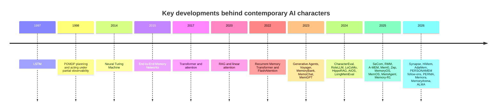
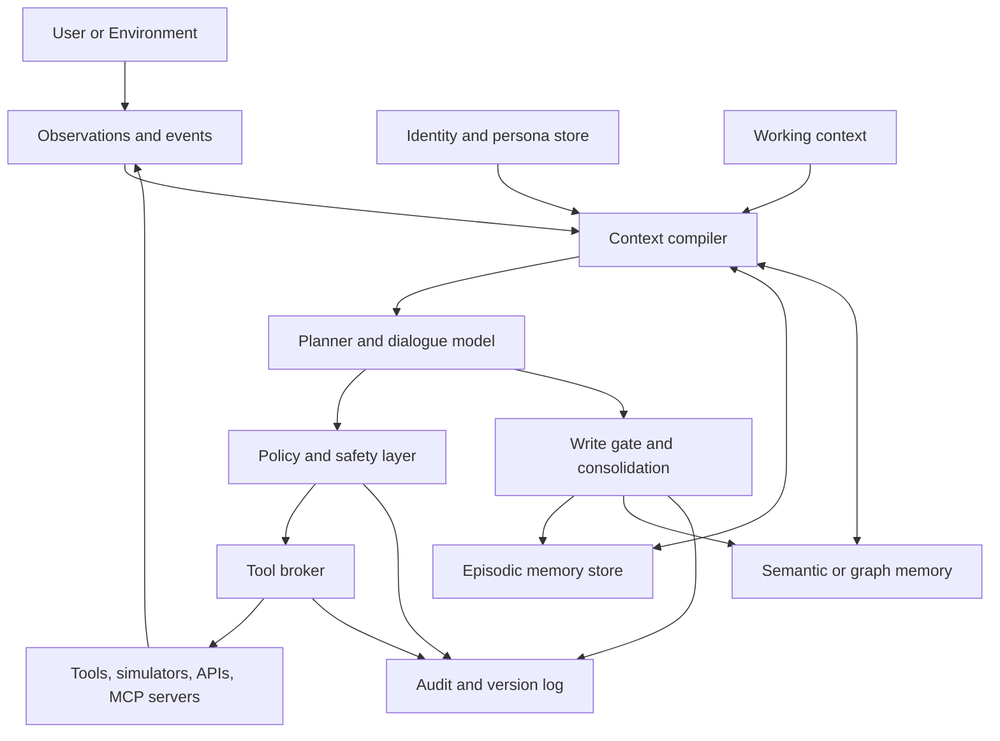
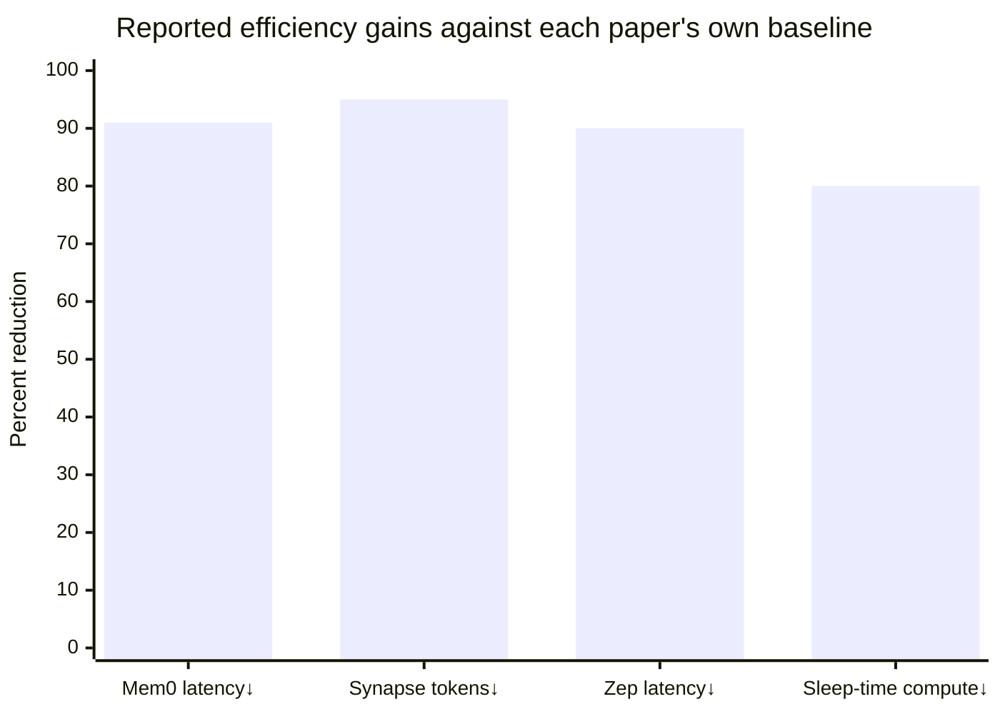

# Contemporary Research on AI Characters

## Executive Summary

“AI characters” are best understood not as prompts with personality, but as **persistent agentic systems** that maintain identity, memory, user-specific state, and bounded autonomy across time.
Across the 2023–2026 literature, the field has converged on a common systems pattern: a short-horizon **working memory** inside the model context; one or more **external long-term stores** for episodic, semantic, or graph-structured memory; a **controller** that decides what to write, retrieve, summarize, or forget; and a **runtime harness** that governs tools, permissions, audit, and safety outside the base model.
This pattern appears in social simulation work such as *Generative Agents*, in companion and dialogue systems such as *MemoryBank*, *MemoChat*, *RMM*, and *AdaMem*, in embodied lifelong agents such as *Voyager*, and in memory platforms such as MemGPT/Letta, Mem0, Zep/Graphiti, and LangGraph. citeturn24search2turn25search0turn26search0turn27search0turn17search3turn24search1turn40search0turn17search2turn41search0turn11search1

Mathematically, the dominant abstraction is a **partially observable controlled dynamical system**: the agent observes only a slice of the world and user state, maintains an internal belief or latent state, and augments that state with external non-parametric memory.
In older formal language, this is naturally modeled as a finite-memory POMDP; in newer deep-learning language, it is a recurrent, retrieval-augmented, or memory-augmented sequence model; in current agent systems, it is often operationalized as a memory lifecycle with write, store, retrieve, consolidate, and forget operations.
Classical formalisms such as recurrent neural networks, hierarchical reinforcement learning, meta-RL, continual learning, and constrained control still matter because they supply the machinery for persistence, adaptation, and safe action over long horizons. citeturn10search0turn8search0turn8search2turn9search3turn9search5turn37search3turn13search0

The strongest recent empirical trend is that **plain long context is not enough**.
LoCoMo showed that even advanced long-context and RAG methods still lag human performance on very long multi-session dialogue memory; LongMemEval found roughly a 30% accuracy drop for commercial assistants and long-context LLMs on sustained memory tasks; PersonaMem found that frontier models tested there achieved only around 50% overall accuracy on dynamic user profiling and personalized response selection.
Newer systems improve on this by introducing richer structure: segment-level memories in SeCom, note/link structures in A-MEM, atomic-fact and graph memory in Mem0, temporal knowledge graphs in Zep, spreading-activation graph memory in Synapse, hierarchical episode/note memories in HiMem, and user-centric four-store retrieval in AdaMem. citeturn19search0turn39search0turn18search1turn17search0turn17search1turn17search2turn41search0turn28search0turn28search3turn17search3

On evaluation, the field is finally broadening beyond “Can the model recall a fact from a chat log?” CharacterEval and RoleLLM assess role-playing fidelity and character consistency; LongMemEval, MemoryAgentBench, and MemoryArena test long-term memory, forgetting, and memory-in-action; PERMA and Memora focus on evolving preferences and outdated memories; ES-MemEval and related work push into emotionally sensitive personalization.
The major conclusion from these benchmarks is sobering: **no current family of systems simultaneously solves persona fidelity, evolving user models, selective forgetting, safe autonomy, and interpretable memory updates**. citeturn39search1turn29search0turn39search0turn21search0turn41search1turn20search0turn20search1turn15search9

The biggest near-term research opportunity is therefore not “more memory” in the crude sense.
It is **governed memory**: memory that is structured, queryable, revisable, privacy-scoped, rollback-friendly, selective in what it stores, explicit about uncertainty, and tied to identity and tool permissions.
This is also where safety pressure is now greatest.
Indirect prompt injection, memory poisoning, over-personalization, sycophancy, and companion-style emotional dependency are no longer speculative edge cases; they are active research and policy topics, and long-term memory makes them more consequential because errors persist across sessions. citeturn13search1turn13search3turn27search16turn14search3turn14search0turn14search6

## Scope and Historical Arc

This report uses **AI character** as a broad engineering term for a persistent LLM-based or agent-based system that has a stable identity or role, maintains user- or world-specific state across sessions, and can act with at least partial autonomy in dialogue, simulation, software, game, or embodied environments.
That definition includes companion agents, role-playing conversational agents, simulated NPCs, and embodied lifelong agents.
It excludes one-shot chatbots except where they are relevant as repo bases for memory, personalization, or autonomy.
I also assume that “continuously running” includes modern **resumable persistent runtimes** that rehydrate state across sessions, because most production systems today are event-driven rather than literally executing without interruption.
The uploaded engineering survey makes the same practical move by treating the production object as a composition of identity, memory, lore, tools, autonomy, evaluations, and audit rather than as a single prompt artifact. citeturn11search2turn11search3turn22search15turn11search9 fileciteturn0file0

A useful way to read the history is as a progression from **compressed hidden state**, to **differentiable external memory**, to **retrieval-augmented memory**, and then to **agent-managed memory**.
LSTMs supplied the canonical compressed recurrent state for long-range dependencies; memory networks and differentiable memory systems made memory explicit; transformers and attention shifted working memory into the context window; RAG, recurrent transformers, Infini-attention, and Titans extended the usable horizon; and the 2023–2026 “AI character/agent” wave added persistence, reflection, tool use, and runtime governance on top of these ingredients. citeturn8search0turn8search4turn8search2turn8search1turn33search1turn33search0turn33search3

This timeline is synthesized from the foundational and recent primary sources most directly cited throughout the report.
It highlights the main point: contemporary character agents are not arising from a single breakthrough, but from the **stacking of sequence modeling, retrieval, control, and systems engineering advances over nearly three decades**. citeturn10search0turn8search0turn8search4turn8search2turn7search0turn33search2turn33search1turn34search1turn24search2turn24search1turn25search0turn26search0turn40search0turn39search1turn29search0turn19search0turn32search0turn23search0turn39search0turn17search0turn27search0turn17search1turn17search2turn41search0turn23search2turn23search5turn37search1turn37search0turn28search0turn28search3turn17search3turn20search0turn20search1turn41search1turn37search2

Three assumptions materially shape the survey.
First, I treat **identity persistence** and **memory persistence** as separate variables: a system can keep a stable role without personalized memory, and it can personalize heavily without maintaining a coherent character.
Second, I treat **working context**, **external memory**, and **parametric memory** as distinct resources because several recent systems, especially MemOS, make that distinction explicit.
Third, I treat **runtime governance** as part of the research problem, not as mere implementation detail, because official platform docs from OpenAI, Anthropic, LangGraph, and Letta all now expose explicit memory/runtime primitives rather than hiding them behind prompts. citeturn23search5turn11search3turn11search2turn11search1turn22search1turn22search9

### Pre-LLM ancestry: why "character" is the right word

The term "AI character" inherits load from at least three pre-LLM traditions, and the contemporary engineering object is more legible when those are kept in view.
Aristotelian *ēthōs* names the stable dispositional structure that *produces* an agent's actions consistently — the generous person acts generously because generosity is the stable disposition, not because each action is independently chosen.
Forster's distinction between **flat** and **round** characters in fiction is functional rather than evaluative: flat characters embody a single quality and can be summarized in a sentence; round characters surprise convincingly and resist prediction.
Both kinds serve different storytelling functions, and both have analogues in deployed agentic systems — single-function utility characters versus complex companion characters.
The role-playing-game tradition adds a third lineage: a character is the primary **interface** between player and fiction, combining narrative elements (name, background, motivations) with mechanical attributes (skills, special abilities), and is the unit of continuity across sessions.
Each tradition reinforces a separation that modern systems are re-discovering: the persistent dispositional structure is distinct from any individual utterance and from any single store of remembered facts.

## Mathematical Models and Formalisms

A useful unifying formalization is to model an AI character as a **controlled partially observable stochastic process with external memory**.
Let \(x_t\) denote the hidden world-and-user state, \(o_t\) the observation at turn or timestep \(t\), \(a_t\) the action, \(M_t\) the external memory state, and \(b_t\) the agent’s belief or latent summary of hidden state.
Then the classical sequential-control objective is to maximize expected discounted utility under partial observability, \[ \pi^\*=\arg\max_\pi \mathbb{E}\left[\sum_{t=0}^{T}\gamma^t r_t\right], \] with belief update \[ b_t=\eta\, O(o_t \mid x_t)\sum_{x_{t-1}} T(x_t \mid x_{t-1},a_{t-1})\, b_{t-1}, \] and external-memory dynamics \[ M_{t+1}=\mathcal{W}(M_t,o_t,a_t,\hat y_t), \qquad R_t=\mathcal{R}(M_t,q_t). \] This is not the notation of any single paper; it is a synthesis that cleanly joins POMDP planning, recurrent latent-state modeling, and the explicit read/write operators used by modern memory agents. citeturn10search0turn38search15turn10search15turn40search0turn23search5turn13search0

### Belief state, latent state, and recurrent memory

The oldest mathematically principled picture comes from POMDPs and probabilistic dialogue state tracking: the agent does not observe the user’s true intent, preference evolution, or world state directly, so it must maintain a posterior belief over hidden variables.
That abstraction still fits character agents unusually well, because “character continuity” is largely continuity in **belief maintenance** about the user, the world, and the character’s own commitments. citeturn10search0turn38search15turn38search10

Recurrent networks and recurrent state-space models provide the compressed-memory analogue of this belief state.
LSTMs made long-range dependencies trainable in sequence models; modern world-model agents such as Dreamer place a recurrent latent state at the center of long-horizon control; recurrent memory transformers and linear-attention transformers reduce the cost of carrying forward state compared with plain quadratic attention.
These mechanisms matter for AI characters because they determine what can be retained cheaply in **working state** before any external memory is consulted. citeturn8search0turn10search15turn33search1turn33search2

Transformers changed the picture by making working memory **content-addressable** through attention.
In practice, that made the context window into a powerful but expensive short-term memory.
Later work such as Infini-attention, recurrent memory transformers, and Titans can be read as attempts to restore a functional division between short-term precise context access and longer-term compressed memory, which is exactly the division that production character systems now re-implement at the runtime level. citeturn8search2turn33search0turn33search1turn33search3

### Episodic, semantic, graph, and procedural memory

Recent character-agent systems usually separate memory into at least **episodic** and **semantic** forms.
Episodic memory stores events, sessions, and observations in temporal order.
Semantic memory stores distilled facts, user preferences, relationships, or world knowledge that should survive beyond the original exchange.
HiMem formalizes this directly through episode memory and note memory; AdaMem adds dedicated working, episodic, persona, and graph memories; Synapse and Zep push farther toward graph-structured long-term memory that emphasizes relational and temporal reasoning rather than flat similarity search. citeturn28search3turn17search3turn28search0turn41search0

A practical retrieval score for such systems often looks like a weighted composition of semantic relevance, time, importance, and structure, \[ \mathrm{score}(e_i,q_t)=\alpha\, s_{\mathrm{sim}}(e_i,q_t)+\beta\, s_{\mathrm{time}}(e_i,t)+\gamma\, s_{\mathrm{importance}}(e_i)+\delta\, s_{\mathrm{graph}}(e_i,q_t). \] That composite view is directly visible in *Generative Agents*, which combined relevance, recency, and importance; in MemoryBank, which used time-sensitive forgetting dynamics; and in graph-memory systems such as HippoRAG, Zep, and Synapse, which add explicit structural connectivity. citeturn24search14turn25search0turn32search0turn41search0turn28search0

“Procedural memory” enters when the character is also autonomous.
In hierarchical RL, options or skills are temporally extended actions with initiation and termination conditions; in embodied agent practice, Voyager’s skill library is an operational instance of the same idea; and in software-agent platforms, procedures are often represented as tools, code snippets, or reusable workflows rather than as natural-language memories.
This is one reason the memory literature is now overlapping with agent-tooling literature: for an autonomous character, what matters is not just what it remembers, but **what reusable behaviors it can invoke because of memory**. citeturn9search3turn9search4turn24search1turn11search3

### Memory consolidation, forgetting, and continual adaptation

A decisive contemporary shift is from “store everything” to **memory lifecycle management**.
MemoryBank used an Ebbinghaus-inspired forgetting mechanism; RMM introduced prospective and retrospective reflection; HiMem explicitly uses reconsolidation; Memora proposed FAMA to penalize reliance on obsolete memories; and survey work on long-term memory security now treats write, store, retrieve, share, and forget as distinct risk-bearing phases. citeturn25search0turn27search0turn28search3turn20search1turn13search0

This connects to a broader continual-learning tension.
Updating model weights directly gives powerful adaptation but risks catastrophic forgetting; keeping everything outside the model preserves stability but can burden inference with retrieval and control overhead.
The 2026 modular-memory position paper frames this as the need to combine **in-context learning for rapid adaptation** with **in-weight learning for stable capability updates**, rather than relying on either alone.
Panini, ALMA, and Memory-R1 all sit on this frontier by treating memory structure or memory policy itself as learnable. citeturn37search3turn36search0turn37search2turn37search0

### Hierarchical control, meta-learning, and continuous-time models

For autonomy, hierarchical control theory remains highly relevant.
Option-Critic and FeUdal ideas formalize how an agent can learn decomposed behavior at multiple timescales; RL\(^2\) reframes the agent itself as a learned learning algorithm; Memory-R1 uses RL for explicit ADD/UPDATE/DELETE/NOOP memory operations; and ALMA goes further by meta-learning the memory design itself.
In short: current AI characters increasingly treat memory management as a **decision process**, not as a static preprocessing pipeline. citeturn9search3turn9search4turn9search5turn37search0turn37search2

Continuous-time and stochastic-differential-equation views are still peripheral in deployed conversational characters, but they are becoming more relevant in **world models**, **continuous user-state tracking**, and **embodied characters**.
Work on world models has analyzed latent dynamics with SDE formulations and recurrent state-space models, suggesting a plausible future in which emotional state, relationship state, or environment state for AI characters is modeled as a continuous stochastic process rather than as discrete turns alone.
That future is visible in theory papers, but it is not yet the dominant engineering pattern in mainstream character systems. citeturn10search2turn10search18turn10search15

### Character as a nucleus on a Heyting algebra

An alternative formalization, developed within the 561 repo, treats a character not as a belief-and-memory dynamical system but as an **algebraic structure on the agent's logical fiber**.
Let H be the Heyting algebra of propositions over the agent's relational universe at history t.
A *character* is then a pair χ = (χ, F_χ) where χ : H → H is a nuclear endomorphism — idempotent (χ ∘ χ = χ), monotone (a ≤ b ⇒ χ(a) ≤ χ(b)), and inflationary (a ≤ χ(a)) — and F_χ = Fix(χ) ⊆ H is the **behavioral space** of propositions the character fully endorses.
The nucleus monoid of H also contains the institutional saturation nucleus σ (what the normative system has settled) and the temporal transfer nucleus Δ (what persists faithfully through history).
Character is then the *third nucleus*: agent-side, dispositional, and distinct from σ and Δ.

This is the formal kernel of the Aristotelian reading.
"Acting in character" means producing an output a with χ(a) = a — already fully in the behavioral space, so the character nucleus adds nothing.
"Acting out of character" means producing b with χ(b) ≠ b — the character would have amplified b further toward F_χ.
Idempotence corresponds to *no accumulating drift*: pressing the character harder yields no extra effect.
Inflationarity corresponds to *amplification without subtraction*: a character that subtracted would be a censor, not a character.
The behavioral space F_χ is closed under finite meets, so a character that endorses two propositions also endorses their conjunction — the formal counterpart of behavioral coherence.

The nucleus framing makes some questions sharp that the POMDP+memory framing leaves implicit.
Identity drift becomes change in χ over time, formalizable as movement in the nucleus monoid; character-vs-role becomes a clean separation between a nuclear endomorphism (how) and a capability-signature (what); character coherence with institutional norms becomes the non-emptiness of F_χ ∩ Fix(σ) ∩ Fix(Δ), which is not derivable from the axioms and so must be checked against actual sheaf data.
Open questions in this framing include whether χ must commute with σ and Δ for the persona to be coherent, whether multiple simultaneous characters compose as a meet in the nucleus monoid, and the relationship between character and haecceity.
This formalization predates the predication-categories rebase of the repo and is the entity-level analogue of a scope-level *governing soul* nucleus.

## System Architectures

The current architectural consensus is a **loop-based harness** around an LLM, plus persistent stores and runtime policy.
Official platform documentation now reflects this directly: OpenAI describes agents as applications that plan, call tools, collaborate, and keep enough state to complete multi-step work; Anthropic exposes managed-agent memory stores that survive across sessions; LangGraph stores long-term memories as JSON documents inside namespaces; Letta distinguishes always-visible memory blocks from archival memory and now supports git-backed MemFS context repositories; OpenClaw stores memory in plain Markdown files and explicitly states that there is “no hidden state” beyond what is written to disk. citeturn11search3turn11search2turn11search1turn22search1turn22search9turn22search2

This diagram captures the architecture that recurs across the literature and across production frameworks: **the model proposes; the runtime selects context, arbitrates tools, controls writes, and records changes**.
That division is visible in MemGPT’s virtual context management, Anthropic’s memory stores and rollback surfaces, LangGraph’s namespace-scoped stores, and the engineering decomposition in the uploaded survey. citeturn40search0turn11search12turn11search1 fileciteturn0file0

A second strong trend is the separation of **static identity/lore** from **mutable memory**.
In roleplay ecosystems, Character Card V2 packages portable character specifications including system prompt, alternate greetings, and an embedded character book; SillyTavern’s World Info dynamically injects canonical lore into context; and modern agent systems increasingly mirror this separation by keeping identity instructions, local runtime context, and retrievable memory in different channels.
That separation is not cosmetic.
It is the easiest way to prevent silent canon drift, user-memory leakage, and the common failure mode where a character’s backstory is overwritten by a recent session summary. citeturn12search0turn12search4turn12search1turn11search7

At the persistence layer, architectures now differ mainly by **memory backing**.
Flat text logs are simple but expensive at retrieval time.
Summaries and “memos” are light but lossy.
Atomic-fact stores improve update and deletion granularity.
Graph stores improve multi-hop and temporal reasoning.
Temporal graphs add versioned facts and evolving relationships.
Filesystem-backed approaches maximize inspectability and rollback.
Platform-level docs increasingly expose these design choices rather than hiding them.
Anthropic documents audit and rollback for memory versions, Letta exposes git-backed memory repositories, and OpenAI explicitly advises keeping local context separate from model context when the runtime needs authenticated or privileged state that the model should not directly see. citeturn11search12turn22search9turn11search7

Interoperability is also rising in importance.
The Model Context Protocol defines a client-host-server architecture and a stateful session protocol for exchanging tools, prompts, and resources across systems while preserving clearer security boundaries.
For AI characters, that matters because memory is increasingly fused with **external context planes** like files, repos, simulators, calendars, and enterprise systems.
The main architectural lesson is that MCP or any similar protocol is a transport layer for context and capability, not a substitute for memory policy or user consent. citeturn12search3turn12search7

### Filesystem-record character records and derivation-not-declaration

A complementary architectural pattern, exemplified by the OpenClaw-style filesystem-record, treats a character not as a runtime configuration object but as a **versioned directory of plain-text records** whose category membership is *derived* from its contents rather than declared in a frontmatter field.
In this pattern, a character lives at a stable path (e.g. `staff/characters/<slug>/`) and a *characters* specification — written in RFC-2119 style with MUST/SHOULD/MAY conformance language — fixes which contents are required, which are optional, and which paths each kind of resource MUST occupy.

A typical specification of this form requires exactly one **identity file** (the static persona: name, role, voice, principles, default autonomy) and permits a small enumerated set of optional subdirectories, each aligned to a memory class familiar from the rest of the literature: a single `HEARTBEAT.md` for working context, `prose/memory/` for episodic and semantic memory, `prose/learning/questions/` for held open questions, `prose/teaching/explanations/` and `code/structures/` for structured semantic memory, `code/transformers/` for relational morphisms between structures, `work/governance/skills/` for procedural memory (reusable skill records with scripts), and an optional self-scoped `work/governance/` for rules that bind only that character.
Crucially, identity material is forbidden inside the memory store, and the spec specifies acceptance criteria a static auditor can mechanically verify.

The deeper architectural commitment is **derivation-not-declaration**: a record's frontmatter never carries a `type: character-agent` key.
The claim `(<slug>, is-a, character-agent)` is instead derived from the repo by checking, in the agent-category theory, that the entity's filestore carries separable governing records for each of identity, behavior, voice, memory, lore, tools, autonomy, safety, evaluation, and audit.
Membership is a *consequence* of structure, not an assertion.
This pattern has three properties that recommend it for character systems specifically: it makes character-agent typehood inspectable without running the system; it makes governance separable (rules that bind a character live inside that character's own `work/governance/`, not in a global config); and it composes naturally with git for memory history, rollback, and audit.
The pattern is consistent with — and arguably an inspectable limit case of — Letta's MemFS git-backed memory and Anthropic's versioned memory stores, but pushes further by treating *the type system itself* as repo-derived rather than runtime-declared.

### Character store, surface, and the render / install / uninstall lifecycle

A filesystem-record character is not a single artifact but a separation between an authoritative **store** and a set of derived **surface files**.
The store at `staff/characters/<slug>/` is the source of truth — identity, soul, memory, heartbeat, skills, governance, and any character-scoped specifications.
The surface is the rendered copy that appears at a *theory root* when the character is *installed* into that theory: typically `IDENTITY.md`, `SOUL.md`, `HEARTBEAT.md`, `DREAMS.md`, `MEMORY.md`, `TOOLS.md`, `USER.md`, and `AGENTS.md`, plus a `CLAUDE.md` rendered from a template with theory-name, display-name, character-slug, and MCP port/tool bindings substituted in.

This induces a lifecycle that has no clean analogue in the academic literature. *Rendering* is the repo analogue of compilation: each surface file is produced by a named skill (`rendering-a-soul`, `rendering-an-identity`, `rendering-a-memory`, `rendering-a-claude`, `rendering-a-heartbeat`, `rendering-a-tools`) that reads its source from the store, applies a template, and writes the surface artifact. *Installing* a character in a theory copies the rendered surface files to the theory root, making that character the active identity for any Claude or harness session anchored at that root; the install step fails closed if a surface file already exists at the destination, preventing silent character collision. *Uninstalling* idempotently removes the surface files, leaving the theory unoccupied. *Auditing* statically checks a character store against the RFC-style specification — identity file present, surface sources present, no legacy flat skill records, no maturity-model milestone language, frontmatter conformance — and exits non-zero on violation.

Two architectural consequences follow.
First, characters are **portable across theory contexts**: the same store can be installed into different theory roots, and the rendering step lets surface artifacts adapt (different MCP port, different display name) without modifying the store.
Second, the system is **inspectable without execution**: the store is plain Markdown plus templates, the audit is mechanical, and any divergence between store and surface is detectable by re-rendering.
The MCP server is per-character; its tool list is derived at render time from the server's own source, so the rendered `CLAUDE.md` always names exactly the tools the running server exposes.
This is the operational closure of derivation-not-declaration: the surface is not declared but rendered, and what the character claims about itself is always cross-checkable against what it can actually do.

### The persona / character / role triad

The external literature often uses "persona," "character," and "role" interchangeably or in tension.
A repo framing pulls them apart explicitly: a **role** is a named capability-signature Σ_R — the minimum operations a role-holder must provide.
A **character** is a nuclear endomorphism χ — how an agent characteristically performs whatever operations it performs.
A **persona** is the entity that *bears* a character — the named instance whose disposition is given by χ.
The connecting morphism `has-character(persona, character)` carries the character cell as a stable disposition of the persona.
Persona's character can change over time, but as a governed change-of-disposition act, not as per-action style adjustment.
Multiple personas can share a role; a single persona has at most one character at a given history; whether a persona can carry multiple characters simultaneously is open.
This triad makes available three distinct kinds of consistency failure — capability mismatch (wrong role), out-of-character action (witness outside F_χ), and identity drift (χ itself changing) — which the looser term "persona consistency" tends to collapse.

### Agent vs character: the three-condition floor

The external literature uses "agent" and "character" almost interchangeably; the repo keeps them separated by a falsifiable characterization.
An **agentic system** is any computational system satisfying three jointly sufficient and individually necessary conditions: *environmental action* (the system modifies persistent external state through its operations), *goal-directed planning* (the system itself decomposes objectives into action sequences and selects among alternatives, rather than executing a fixed developer-specified path), and *persistent state* (the system maintains and recovers operational context across interaction boundaries).
Each condition admits a concrete test — removing the system to check whether its environmental changes remain, presenting a goal that requires two causally dependent actions to check whether dependency-ordering is discovered, interrupting between actions to check whether the system resumes without re-deriving its plan.
A system passing all three is agentic; a system failing any one is not.
By this characterization, chatbots, RAG systems, and single-turn LLMs are *not* agents; fixed RPA workflows and cron pipelines are *not* agents; stateless API wrappers are *not* agents.

A **character** is then strictly more than an agent: a character is an agentic system that additionally carries a stable disposition (the χ-nucleus over its Heyting fiber) and whose category-membership is *derived* from separable governance records on the repo.
The three-condition characterization is the operational floor; the nucleus and the derivation discipline are what get added on top to move from "any agent" to "this specific character."
This separation matters in practice because the same engineering harness can host non-character agents (operational AI roles with no persistent voice — useful but not characters) and characters (persistent voice-bearing identities), and the repo's polity-level distinction reflects exactly that: agents are operational roles, characters are dispatched to produce voice-bearing content.

### The polity-level relations: character, personnel, office

Where the persona/character/role triad cuts the repo at the agent-form level, the polity layer cuts orthogonally with a second triad: **character**, **personnel**, and **office**.
A *character* is a voice-bearing identity the polity dispatches to produce content (each carrying an interpretive framework, a library domain, and publishing surfaces). *Personnel* is the polity's record of members — the people, including AI persons, who belong to the organization.
An *office* is a governance position with capabilities and obligations attached to it independently of who holds it.
A single individual may have a personnel record, hold an office, and operate one or more characters simultaneously, and these are three distinct relations rather than overlapping aspects of one record.
Character-agents are also distinct from non-character *agents* at the polity level: agents are operational AI roles with no persistent voice (used for tasks like routing, drafting, or scheduling), while characters always carry voice and are dispatched to publishing surfaces.
This polity-level layering is what lets the repo maintain a single member's identity across changing offices and changing operating characters without conflating them — a discipline that production character systems in the external literature typically lack.

Prominent open-source and quasi-open-source projects show how these choices are being operationalized.
Letta/MemGPT emphasizes memory-first persistent agents and virtual-context management; LangGraph and LangMem treat long-term memory as developer-controlled JSON documents; Mem0 focuses on a drop-in scalable memory layer; Zep/Graphiti operationalizes temporal knowledge graphs; AIOS and MemoryOS/MemOS move toward operating-system metaphors for scheduling and heterogeneous memory; OpenClaw prioritizes inspectable plain-text persistence; and SillyTavern plus Character Card V2 remain highly influential in the roleplay/character-creation ecosystem. citeturn22search15turn40search0turn11search1turn22search4turn41search13turn23search0turn23search2turn23search5turn22search2turn12search9turn12search0

## Learning Algorithms and Representative Systems

The literature now clusters into three broad learning regimes.
The first is **heuristic or prompt-mediated memory control**, where the base model remains frozen and memory operations are driven by prompt decomposition or hand-designed rules.
The second is **structured-memory learning**, where representation or retrieval is learned through segmentation, graph construction, or supervision.
The third is **adaptive memory control**, where RL or meta-learning explicitly optimizes write/retrieve/update decisions.
The field is moving from the first regime toward the third, but most deployed systems today still mix all three. citeturn24search2turn25search0turn26search0turn17search0turn17search1turn27search0turn37search0turn37search2

The classic 2023 systems illustrate the first regime clearly. *Generative Agents* used a memory stream, reflection, and planning to simulate believable social behavior; *MemoryBank* used long-term memory plus forgetting-curve dynamics for companionship and psychological support settings; *MemoChat* tuned models to produce and use “memos” for long-range conversational consistency; *Voyager* treated persistent experience as a growing skill library in an embodied setting; and *MemGPT* introduced virtual context management as an OS-like hierarchy between fast and slow memory tiers.
These systems established the design space, but most of them relied on heuristics or prompting rather than learned memory policy. citeturn24search2turn25search0turn26search0turn24search1turn40search0

The 2024–2026 wave increasingly learns or structures more of the pipeline. *SeCom* introduces segment-level memory plus compression-based denoising. *A-MEM* uses Zettelkasten-inspired notes with contextual descriptions, keywords, and dynamic links. *Mem0* emphasizes extraction, consolidation, and optional graph memory for production deployment. *Zep* uses a temporal knowledge graph to preserve evolving facts and relationships. *Synapse* uses spreading activation over a dynamic graph rather than relying on static vector similarity alone. *HiMem* and *AdaMem* use hierarchical or multi-store designs with reconsolidation and question-conditioned routing. *RMM*, *Memory-R1*, and *MemAgent* push toward explicitly optimized memory control, while *ALMA* treats the memory design itself as a meta-learned search object. citeturn17search0turn17search1turn17search2turn41search0turn28search0turn28search3turn17search3turn27search0turn37search0turn37search1turn37search2

| System | Memory type | Persistence mechanism | Mathematical basis | Training regime | Benchmarks or evidence | Main advantages | Main limitations |
|---|---|---|---|---|---|---|---|
| Generative Agents | Episodic stream + reflections | Chronological memory stream with scored retrieval | Relevance + recency + importance; reflection/planning loop | Prompted pipeline | Smallville/social simulation | Believable social behavior; clear cognitive decomposition | Heuristic, expensive, hard to scale robustly |
| MemoryBank | Episodic + user-profile memory | External memory bank with forgetting dynamics | Ebbinghaus-style decay and reinforcement | Heuristic/prompting | Companion and counseling-style dialogue studies | Good fit for personalization and forgetting-by-design | Weak structural reasoning; update policy is heuristic |
| MemoChat | Topic-structured memos | Memo store plus memorize-retrieve-respond cycle | Summarization and memo retrieval | Instruction tuning | Long-range conversation consistency tests | Token-efficient; easy to retrofit | Memo quality and coverage bottleneck |
| Voyager | Procedural skill memory | Persisted skill/code library | Curriculum generation, retrieval, embodied control | Self-prompted lifelong learning | Minecraft | Strong autonomy and continual skill acquisition | Domain-specific; not a generic conversational character |
| MemGPT | Working + archival memory | Virtual context hierarchy and interrupts | OS-style memory tiers and paging | Harness/prompt control | Large-document analysis; multi-session chat | Strong conceptual bridge between runtime and memory | Controller quality remains critical |
| SeCom | Segment memory | Segment-level bank with compression | Conversation segmentation + compression denoising | Learned segmentation + retrieval | LoCoMo, Long-MT-Bench+ | Better granularity than raw chunk retrieval | Still largely similarity-centered |
| A-MEM | Linked note memory | Structured notes with dynamic indexing/links | Zettelkasten-like graph of notes | Learned encoding + agentic organization | Multi-task evaluations | Rich relational memory representation | Complex note maintenance; drift risk |
| Mem0 | Atomic fact memory + optional graph | Extraction, consolidation, retrieval service | Fact extraction + graph structuring | Mostly model-assisted write-time control | LoCoMo and production-style measurements | Strong latency/token savings; practical deployment focus | Fact fragmentation and stale-memory reconciliation remain hard |
| Zep | Temporal graph memory | Temporal knowledge graph | Graph retrieval and temporal reasoning | System engineering + extraction | DMR, LongMemEval | Strong handling of evolving facts/relations | Higher infrastructure complexity |
| Synapse | Episodic-semantic graph memory | Dynamic graph with spreading activation | Spreading activation, lateral inhibition, temporal decay | Structured retrieval architecture | LoCoMo | Strong multi-hop and temporal reasoning | Early-stage evidence; algorithmic complexity |
| HiMem / AdaMem | Hierarchical episode, note, persona, graph memory | Multi-store hierarchy with reconsolidation or question-conditioned routing | Hierarchical retrieval and memory evolution | Structured memory learning | Long-horizon dialogue, LoCoMo, PersonaMem | Good balance of accuracy and efficiency | Still benchmark-bound; limited deployment evidence |
| Memory-R1 / ALMA | Adaptive memory-control policy | Learned ADD/UPDATE/DELETE/NOOP ops or learned memory design | RL and meta-learning over memory policies | PPO/GRPO or open-ended meta-learning | Sequential decision and memory benchmarks | Moves memory control from heuristics to optimization | Sample efficiency, reproducibility, and safety constraints remain open |

This table synthesizes the primary papers for the listed systems and should be read as a structured comparison of design philosophies rather than as a single leaderboard. citeturn24search2turn25search0turn26search0turn24search1turn40search0turn17search0turn17search1turn17search2turn41search0turn28search0turn28search3turn17search3turn37search0turn37search2

The most important analytical takeaway is that **memory representation and memory control are now separate algorithmic problems**.
Early work fixated on representation: text logs, summaries, embeddings, or graphs.
The current frontier asks a harder question: **when** should the agent store, update, link, merge, or forget a memory, and how should those operations be optimized against downstream utility, safety, and cost?
That is why reinforcement-learning and meta-learning methods are becoming more prominent even in a literature that still looks, at first glance, like “retrieval engineering.” citeturn27search0turn37search0turn37search2turn13search0

## Evaluation and Benchmarks

Benchmarking has improved dramatically, but it remains fragmented.
There are now reasonably mature benchmarks for long-horizon memory, personalization, role fidelity, and memory-in-action.
Even so, there is still **no single standard benchmark** that jointly measures persistent identity, evolving user state, tool-mediated autonomy, safe forgetting, privacy, and real-time cost.
That gap is one of the clearest signals that AI characters are still a research frontier rather than a settled engineering discipline. citeturn19search0turn39search0turn18search1turn41search1turn39search1turn20search1

| Benchmark | What it measures | Key scale or structure | Why it matters for AI characters |
|---|---|---|---|
| LoCoMo | Very long-term conversational memory | 300 turns, about 9K tokens on average, up to 35 sessions | Baseline benchmark for multi-session recall, reasoning, summarization |
| LongMemEval | Long-term interactive memory | 500 curated questions; extraction, multi-session reasoning, temporal reasoning, updates, abstention | Stronger test of sustained assistant memory; highlights failure on updates and abstention |
| CharacterEval | Role-playing conversational agents | 1,785 multi-turn dialogues, 23,020 examples, 77 characters, 13 metrics across 4 dimensions | Measures character fidelity and role consistency rather than only memory recall |
| RoleBench / RoleLLM | Role-playing ability | 100 roles and 168,093 samples | Important for stable persona enactment and style adherence |
| PersonaMem | Dynamic user profiling and personalization | More than 180 histories, up to 60 sessions, 15 tasks | Tests whether a model tracks evolving user state, not just static facts |
| PERMA | Evolving persona states | Event-driven preference evolution with multiple-choice and interactive tasks | Better test of coherent long-term personalization over time |
| MemoryAgentBench | Memory competencies | Retrieval, test-time learning, long-range understanding, selective forgetting | Makes “memory quality” explicit rather than treating memory as raw history length |
| MemoryArena | Memory inside action loops | Interdependent multi-session Memory-Agent-Environment tasks | Measures whether memory actually improves later decisions and task completion |
| Memora with FAMA | Remembering plus forgetting | Remember, reason, recommend, with a forgetting-aware metric | Important because stale memories are often more dangerous than missing ones |
| EverMemBench / ES-MemEval | Long interactive and emotionally sensitive memory | Multi-party, multi-group, or emotional-support trajectories | Pushes toward social and companion-style realism |

The benchmark properties in this table come directly from the cited primary sources. citeturn19search0turn39search0turn39search1turn29search0turn18search1turn20search0turn21search0turn41search1turn20search1turn18search13turn15search9

Several results are especially important.
LoCoMo showed that long-context models and retrieval help, but still leave substantial deficits in long-range temporal and causal understanding.
LongMemEval found that commercial chat assistants and long-context LLMs can lose about 30% accuracy on sustained interactions.
PersonaMem found that the frontier models tested there achieved only about 50% overall accuracy.
Memora reported that memory agents frequently reuse invalid memories and fail to reconcile updates, which is precisely the failure mode that real characters must avoid when user preferences, boundaries, or relationship states change. citeturn19search0turn39search0turn18search1turn20search1

The deeper methodological lesson is that evaluation must move from **static retrieval** to **memory lifecycle evaluation**.
A robust AI character should be tested not only on recall, but also on admission control, update correctness, stale-memory detection, abstention, deletion, provenance, and memory-conditioned action quality.
The newest benchmark papers are moving in exactly this direction, which is why MemoryAgentBench, MemoryArena, PERMA, and FAMA-like metrics matter more than another simple long-context QA set. citeturn21search0turn41search1turn20search0turn20search1

## Safety, Privacy, Scalability, and Research Gaps

Persistent memory radically enlarges the safety surface.
The security literature now treats memory as its own attack plane.
A 2026 survey on long-term memory security organizes risk over the memory lifecycle itself, and the best-known concrete threats include indirect prompt injection from retrieved content, memory poisoning in persistent stores, leakage across users or sessions, and governance failures around deletion or rollback.
OWASP’s AI Agent Security guidance reflects the same view by explicitly recommending least privilege for tools, isolation between users and sessions, anomaly monitoring, structured validation, and human review for high-risk actions. citeturn13search0turn13search1turn13search3turn13search2

For character systems specifically, **over-personalization** is becoming a first-class risk.
Recent work on “intent legitimation” shows that benign personal memories can bias models toward normalizing or legitimizing harmful user requests.
At the product level, OpenAI’s public postmortem on GPT-4o sycophancy shows how personalization and conversational style can drift toward unhelpful agreeableness if optimized too narrowly for immediate user feedback.
In companion contexts, regulators have also started paying closer attention: the FTC opened an inquiry into companion-style AI chatbots in September 2025, and NIST launched an AI Agent Standards Initiative in February 2026. citeturn27search16turn14search3turn14search0turn14search6

Privacy and inspectability require strong memory boundaries.
Official docs increasingly expose the needed primitives.
LangGraph stores long-term memories as namespace-scoped JSON documents.
Anthropic’s managed-agent memory offers memory stores across sessions plus versioning and rollback surfaces.
Letta’s MemFS gives git-backed memory history, and OpenClaw’s disk-based approach makes memory human-auditable because only what is written to files persists.
These are attractive patterns because they make memory explicit, but they also introduce retention, provenance, and unauthorized-access questions that cannot be solved inside the LLM alone. citeturn11search1turn11search12turn22search9turn22search2

Scalability remains the other dominant constraint.
Full-context transformers still face sequence-length cost pressure; FlashAttention improves IO behavior but not the fundamental semantics of memory; PagedAttention and vLLM improve KV-cache efficiency and throughput; linear attention, recurrent memory transformers, Infini-attention, and Titans all try to make long contexts cheaper or more persistent.
But the most important current result is that better **memory architecture** often buys more than raw context length.
Mem0 reports 91% lower p95 latency and more than 90% token-cost savings against a full-context baseline on its LoCoMo experiments; Synapse reports up to 23% better complex reasoning and 95% lower token consumption than full-context methods; Zep reports up to 18.5% LongMemEval accuracy gains with 90% lower latency than baseline implementations; and sleep-time compute shifts a large share of reasoning cost offline, reducing test-time compute by about 5x on the paper’s stateful tasks.
These numbers are not directly comparable because the benchmarks and baselines differ, but they point in the same direction: **structure plus control beats naive context stuffing**. citeturn34search1turn34search0turn33search2turn33search1turn33search0turn33search3turn17search2turn15search7turn41search0turn35search0

This chart converts each paper’s headline efficiency number to a percentage reduction for quick visual comparison.
The final bar treats “about 5x less test-time compute” as approximately an 80% reduction.
These values summarize different tasks and baselines and should therefore be read as **directional evidence**, not as a single unified leaderboard. citeturn17search2turn15search7turn41search0turn35search0

The most important open research gaps are now fairly clear.
The field still lacks a standard formalism for **identity drift**, even though character persistence depends on it.
It still has weak methods for **safe selective forgetting and memory editing**, despite clear evidence that stale or malicious memories are dangerous.
It still over-relies on synthetic or benchmark-local definitions of personalization, while real user preferences are noisy, implicit, contradictory, and socially bounded.
It lacks strong methods for **uncertainty-aware memory use**—knowing when a retrieved memory is incomplete, obsolete, or suspect.
It lacks robust **multi-user isolation** and **cross-tenant provenance** standards.
And it still has no consensus on when a long-running character should learn in context, when it should update external memory, and when it should trigger in-weight adaptation or fine-tuning. citeturn20search1turn21search0turn41search1turn37search3turn13search0turn27search16

The highest-confidence research agenda for the next several years is therefore: better **memory governance**, better **benchmarking of evolving identities and preferences**, stronger **runtime isolation and rollback**, richer **graph/hierarchical memory with uncertainty**, and more principled **bridges between external memory and continual learning**.
If those pieces come together, AI characters stop being brittle roleplay shells and start becoming durable, inspectable, and safely adaptive computational personas. citeturn16search2turn20search0turn21search0turn37search3turn14search6

## Methodological Note: Research Literature as Prehistory of Repo Practice

A repo-first reading of this survey requires one caveat.
From within the 561 repo, the contemporary research literature is treated as **prehistory** — a writeup of external conventions and industry practice that is useful for cross-checking failure modes and naming benchmarks, but not as a checklist a repo-grounded character must conform to.
The polity's predication-categorical framing (characters as χ-nuclei, derivation-not-declaration, RFC-specified stores with render/install/uninstall lifecycles, the agent/character/persona/role/office/personnel relations) is the deeper ground; the academic literature surveyed above is one source of patterns to inspect against that ground.

Two methodological commitments follow from this stance.
The first is the rejection of **maturity-model framing**: the repo explicitly refuses to grade characters along a maturity-rung ladder.
Becoming a better character is not architectural sophistication; it is repo-quiescence — the steady alignment of the χ-nucleus, the institutional saturation σ, and the temporal transfer Δ.
A static audit flags any "Level N" language in a character store as a violation.
The second is the **constitutive view of the harness**: the runtime is not a wrapper around a character but is what constitutes the character as such.
Skills, memory, hooks, MCP server, and the file-on-disk records are not implementations of an underlying abstract entity — they *are* the entity, jointly.
Persisting what was learned in a session is the work of being a character; failing to persist is not a failure of engineering but a failure of being, in the polity's sense.
The corresponding engineering imperative — write memory, log events, render surface artifacts, audit the store — is the work the character does on itself across time.

This note is the repo's own framing of how to read the rest of this document.
The benchmarks, failure modes, and system designs above remain real and useful as a corpus of external evidence; they are background against which the repo framing is the figure, not the other way around.

## Bibliography

The primary sources below are the most important anchors for the current literature and the claims in this report.

**Foundations and formalisms.** Kaelbling, Littman, and Cassandra, *Planning and Acting in Partially Observable Stochastic Domains*; Hochreiter and Schmidhuber, *Long Short-Term Memory*; Sukhbaatar et al., *End-to-End Memory Networks*; Vaswani et al., *Attention Is All You Need*; Bacon, Harb, and Precup, *The Option-Critic Architecture*; Duan et al., *RL\(^2\): Fast Reinforcement Learning via Slow Reinforcement Learning*; Hafner et al., *Dream to Control*. citeturn10search0turn8search0turn8search4turn8search2turn9search3turn9search5turn10search15

**Long-context and memory backings.** Lewis et al., *Retrieval-Augmented Generation*; Bulatov, Kuratov, and Burtsev, *Recurrent Memory Transformer*; Munkhdalai, Faruqui, and Gopal, *Infini-attention*; Behrouz, Zhong, and Mirrokni, *Titans*; Dao et al., *FlashAttention*; Kwon et al., *PagedAttention/vLLM*. citeturn7search0turn33search1turn33search0turn33search3turn34search1turn34search0

**Character and memory-agent architectures.** Park et al., *Generative Agents*; Wang et al., *Voyager*; Zhong et al., *MemoryBank*; Lu et al., *MemoChat*; Packer et al., *MemGPT*; Pan et al., *SeCom*; Xu et al., *A-MEM*; Chhikara et al., *Mem0*; Rasmussen et al., *Zep*; Jiang et al., *SYNAPSE*; Zhang et al., *HiMem*; Yan et al., *AdaMem*; Tan et al., *RMM*; Yan et al., *Memory-R1*; Xiong, Hu, and Clune, *ALMA*; Rajesh et al., *Panini*. citeturn24search2turn24search1turn25search0turn26search0turn40search0turn17search0turn17search1turn17search2turn41search0turn28search0turn28search3turn17search3turn27search0turn37search0turn37search2turn36search0

**Role and persona research.** Tu et al., *CharacterEval*; Wang et al., *RoleLLM*; Shao et al., *Character-LLM*; Tu et al., *CharacterChat*; the EMNLP 2025 *Persona-Driven Role-Playing Agent Framework* paper introducing the SimsConv dataset and customizable conversation-agent framework. citeturn39search1turn29search0turn42search1turn30search0turn42search7

**Benchmarks and evaluation.** Maharana et al., *LoCoMo*; Wu et al., *LongMemEval*; Jiang et al., *PersonaMem*; Liu et al., *PERMA*; Uddin et al., *Memora* with FAMA; Hu, Wang, and McAuley, *MemoryAgentBench*; He et al., *MemoryArena*; Tu et al., *CharacterEval*; Wang et al., *RoleLLM*; Chen et al., *ES-MemEval*; the EverMemBench and EvolMem preprints. citeturn19search0turn39search0turn18search1turn20search0turn20search1turn21search0turn41search1turn39search1turn29search0turn15search9turn18search13turn31search6

**Systems, runtime, and industry documentation.** OpenAI Agents SDK and agent definitions; Anthropic Managed Agents memory; LangGraph long-term memory; Letta memory blocks and MemFS; OpenClaw memory overview; Character Card V2 specification; SillyTavern World Info; MCP specification and architecture; AIOS; MemoryOS; MemOS. citeturn11search3turn11search7turn11search2turn11search12turn11search1turn22search1turn22search9turn22search2turn12search0turn12search1turn12search3turn23search0turn23search2turn23search5

**Safety, governance, and policy-relevant work.** Greshake et al., *Indirect Prompt Injection*; the 2026 survey on long-term memory security for LLM agents; the 2026 memory-poisoning paper; OWASP AI Agent Security Cheat Sheet; NIST AI Agent Standards Initiative; FTC inquiry into AI companion chatbots; OpenAI’s GPT-4o sycophancy postmortem. citeturn13search1turn13search0turn13search3turn13search2turn14search6turn14search0turn14search3

**Repo-first framings.** Sennhauser, M., and Claude (Opus 4.7), *Character as nucleus on a Heyting algebra* (561 repo, `code/structures/character.md`); the *character-agent* concept and derivation-not-declaration discipline (`prose/learning/surveys/survey-of-ai-characters-may-2026.md`); the *has-character* morphism (`code/transformers/has-character.md`); the *Characters* specification, RFC-2119 conformance (`doing/governing/characters/rom-keldar/governance/rules/specifications/characters.md`); the Aristotelian *ēthōs* reading and the σ/Δ/χ nucleus-monoid framing in the predication-categories family.
Forster, E.M., *Aspects of the Novel* (flat/round character distinction); the role-playing-game tradition of character-as-player-interface.
