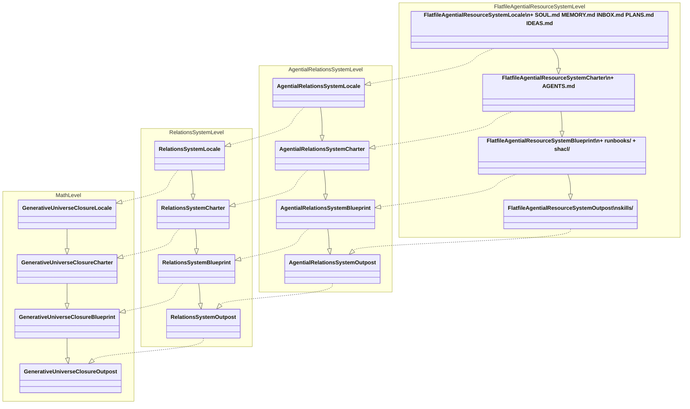

# Flatfile Agential Resource System — C4 Diagram

C4 notation.
Current level: Container.
Actors and containers only — component level is open texture.

```mermaid
C4Container
    title Flatfile Agential Resource System — Container Level

    Person(human, "Human Operator", "Issues instructions, reviews output, resolves ambiguity. Reads and writes files directly.")
    Person(ai, "AI Assistant", "Reads entity files, follows skills, executes runbooks, deposits messages across locale boundaries.")

    System_Boundary(fars, "Flatfile Agential Resource System") {

        Container(math, "math/", "Algebra locale", "Establishes fiber data: T, H_t, sigma_t, Delta_t. Pure mathematics. Skills: improve-math, write-unit, critique-unit, audit-math-compliance, classify-unit-frontmatter, and others.")

        Container(proof, "proof/", "Language locale", "Formalizes math results in Lean 4. Skills: improve-proofs, build, close-sorry, fix-error, read-math.")

        Container(spec, "spec/", "Geometry locale", "Encodes concepts, conventions, constraints governing encoding across the repo. Skills: improve-spec, audit-relation-coverage, derive-unit-relations, propose-grounding.")

        Container(src, "src/", "Dynamics locale", "Implements what spec describes. Skills: improve-src. Largely unimplemented.")

    }

    System_Ext(git, "Git", "Version control. All history is carried in git. The file system is the source of truth; git is the audit log.")

    Rel(human, math, "reads and writes files")
    Rel(human, proof, "reads and writes files")
    Rel(human, spec, "reads and writes files")
    Rel(human, src, "reads and writes files")

    Rel(ai, math, "reads entity files, invokes skills")
    Rel(ai, proof, "reads entity files, invokes skills")
    Rel(ai, spec, "reads entity files, invokes skills")
    Rel(ai, src, "reads entity files, invokes skills")

    Rel(math, proof, "upstream", "proof reads math; nothing downstream modifies math")
    Rel(proof, spec, "upstream", "spec reads proof; nothing downstream modifies proof")
    Rel(spec, src, "upstream", "src reads spec; nothing downstream modifies spec")

    Rel(math, spec, "message", "deposit-message-in-agent-inbox → spec/INBOX.md")
    Rel(spec, math, "message", "deposit-message-in-agent-inbox → math/INBOX.md")
    Rel(proof, spec, "message", "deposit-message-in-agent-inbox → spec/INBOX.md")
    Rel(spec, proof, "message", "deposit-message-in-agent-inbox → proof/INBOX.md")
    Rel(spec, src, "message", "deposit-message-in-agent-inbox → src/INBOX.md")

    Rel(fars, git, "versioned by", "all writes committed to git; history is the audit log")
```

---

## Growth stages — component structure

What each stage is made of, down to spec entity types.
`?
` = the spec unit for this type does not yet exist.
Each stage accumulates all components from the stages before it.

```mermaid
C4Component
    title FARS Growth Stages — Component Structure

    Container_Boundary(outpost, "Outpost: {id}/ + skills/") {
        Component(entity, "{id}.md", "RelationalEntity", "id, description, frontmatter relations — canonical identity")
        Component(skill, "skills/{op}.md", "Skill (carries Operation)", "Named operation as first-class node in R — U_G cond. 4: exponential closure")
    }

    Container_Boundary(blueprint, "Blueprint: + runbooks/ + shacl/") {
        Component(runbook, "runbooks/{rb}.md", "Runbook", "Structural procedure operating on scope — U_G cond. 6: generative operations")
        Component(shape, "shacl/{id}-*.ttl", "FlatfileAgentialResourceSystemShape", "Constraint on valid sub-configurations — U_G cond. 5: subobject classification")
    }

    Container_Boundary(charter, "Charter: + AGENTS.md") {
        Component(agents, "AGENTS.md", "? AgentsCommunityDeclaration", "Who acts here, under what policies — the Grothendieck topology for this scope")
    }

    Container_Boundary(locale, "Locale: + SOUL.md + MEMORY.md + INBOX.md + PLANS.md + IDEAS.md") {
        Component(soul, "SOUL.md", "? Soul", "Governing principles of the constituted community — first act of the live locale")
        Component(memory, "MEMORY.md", "MemoryEntry*", "Accumulated cross-session knowledge — sheaf accumulation, U_G cond. 7")
        Component(inbox, "INBOX.md", "Message*", "Incoming sections from other locales — sheaf gluing activated, U_G cond. 7")
        Component(plans, "PLANS.md", "Plan (OperationItem*)", "Active work queue — generative operations running")
        Component(ideas, "IDEAS.md", "Idea*", "Uncommitted potential work — pre-queue material")
    }

    Rel(outpost, blueprint, "extends")
    Rel(blueprint, charter, "extends")
    Rel(charter, locale, "extends")
```

---

## Growth-stage implementation hierarchy

Solid arrow (`--|>`): `extends` — each stage adds structure to the one before it within the same level.
Dashed arrow (`..|>`): `implements` — each level is a concrete realization of the level above it.



---

## Four-component correspondence per locale

Each locale satisfies [Container](../../../../../../../../../../../../../../../../../content/text/glossary/terms/container.md) by instantiating the four relational machine components:

| Locale | RelationalMachineInterface | DataStore | Engine | Observation Layer |
|---|---|---|---|---|
| math/ | INBOX.md | .md entity files | improve-math skill | outbound messages; settled math entitys |
| proof/ | INBOX.md | Lean source + .md files | improve-proofs skill | outbound messages; verified Lean terms |
| spec/ | INBOX.md | .md spec files | improve-spec skill | outbound messages; settled spec entities |
| src/ | INBOX.md | source files | improve-src skill | outbound messages; running implementations |

---

## Root-level runbooks

These runbooks operate across locale boundaries and are available to any agent:

| Runbook | Role |
|---|---|
| `agent-loop` | Runs the full improvement loop for a locale |
| `triage-inbox` | Processes all unread messages in a locale's INBOX.md |
| `mine-ideas-to-plans` | Promotes ready IDEAS entries to PLANS |
| `execute-plan-queue` | Works through the PLANS queue |
| `add-message` | Deposits a message into a locale's INBOX.md |
| `add-operation-item` | Adds a OperationItem to a locale's PLANS.md |
| `add-idea` | Adds an Idea to a locale's IDEAS.md |
| `add-memory-entry` | Appends a MemoryEntry to a locale's MEMORY.md |
| `acknowledge-message` | Marks a message acknowledged and creates a OperationItem |
| `derive-relations` | Audits and derives relation predicates for uncovered entities |
| `propose-grounding` | Evaluates a grounding claim through the saturation conditions |

---

## Open texture points

- src/ component level: not yet implemented; no components to diagram
- Cross-locale reads: agents in downstream locales read upstream locale files directly; this is not shown as a Rel because it is permitted by default (see AGENTS.md) and does not go through a message
- Root-level skills/ directory: shared skills available to all agents not yet shown
- Lean build system (lake) is invoked by proof/ skills but not itself a container in this system
