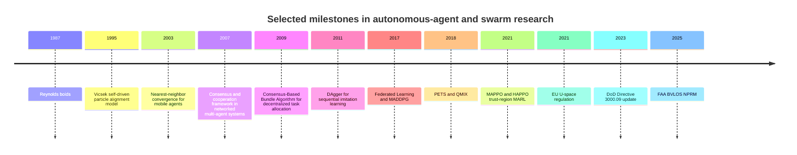
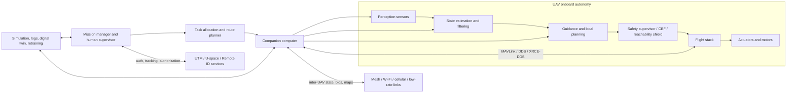
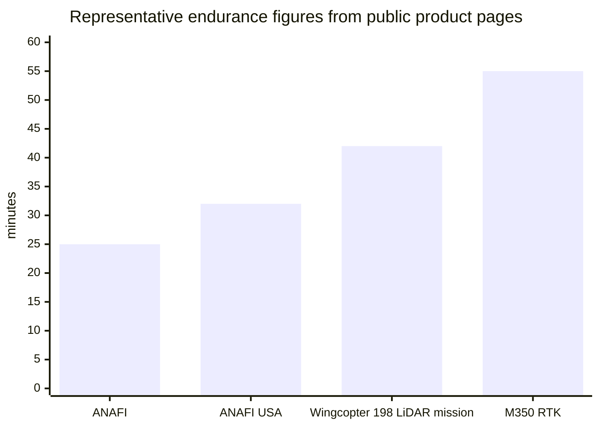

# Autonomous Agents and Drone Swarms: Technical Foundations, System Architecture, Assurance, and Governance

**Standalone report for organizational distribution** **Date basis:** May 2026 **Scope:** autonomous agents, drone swarms, multi-agent control, learning-enabled autonomy, communications, assurance, cybersecurity, civil regulation, defense governance, and societal impacts.

## Structuration rationale

The source piece is strongest when read as a layered analysis rather than a chronological survey.
For organizational distribution, the most effective structure is:

1. **Executive summary and key conclusions** — what decision-makers need to know first.
2. **Definitions and taxonomy** — common vocabulary for technical, policy, and procurement conversations.
3. **Mathematical foundations** — the control, graph, optimization, game-theoretic, and estimation backbone.
4. **Learning and AI methods** — where MARL, imitation learning, federated learning, foundation models, and safety-learning fit.
5. **Communications, hardware, and systems architecture** — the operational constraints that determine whether swarm concepts work outside simulation.
6. **Verification, security, resilience, and testing** — the assurance stack required for safety-critical use.
7. **Civic and defense contexts** — the regulatory, ethical, and governance environment.
8. **Organizational implications** — how organizations should evaluate readiness, risks, and next steps.
9. **Open questions, limitations, and references** — what remains unresolved and where the evidence base comes from.

This structure preserves the technical depth of the source while making the report usable by mixed audiences: leadership, engineering, safety, cybersecurity, legal, policy, and research teams.

## Citation and evidence note

The citation markers embedded in this draft are preserved from the source evidence log.
For internal circulation, they function as traceability markers to the source evidence set.
For external publication, they should be normalized into full bibliographic entries or footnotes with stable URLs, authors, publication venues, and access dates.

## Executive summary

As of May 2026, the strongest autonomous drone-swarm systems are not purely “AI-first” or purely “control-theoretic.” The practical state of the art is layered: graph-based coordination, estimation, and safety filtering at the lower and middle levels; optimization and distributed task allocation above that; and learned perception or policy layers where model uncertainty or task variation is too large for hand-designed rules.
The mathematical backbone remains consensus on graphs, rigidity-based formation control, stochastic estimation, and constrained optimization.
Learning methods such as MADDPG, QMIX, MAPPO, HAPPO, and graph-control-barrier-function methods are important, but in safety-critical deployments they are increasingly wrapped by certification-oriented tools such as Hamilton–Jacobi reachability, barrier certificates, and set-based neural verification rather than trusted alone. citeturn25view0turn25view1turn25view4turn35view5turn35view6turn36view0turn35view8turn35view3turn35view2turn35view0

Scalability is limited less by raw onboard compute than by communication, spectrum, synchronization, and energy.
Inter-UAV coordination can use anything from BLE and IEEE 802.15.4 class links to Wi‑Fi, LoRaWAN, and cellular/5G; however, their trade spaces are radically different in data rate, reliability policy, duty cycle, and network topology.
Real deployments therefore depend on communication-aware control, event-triggered synchronization, compressed state exchange, and degraded-mode autonomy when links fail.
Middleware stacks now commonly pair a flight controller such as PX4 or ArduPilot with a companion computer using MAVLink and increasingly ROS 2/DDS or uXRCE-DDS bridges; this is efficient for research and prototyping, but it introduces difficult QoS and wireless-fragmentation tuning problems in fielded systems. citeturn39view1turn39view2turn39view3turn39view4turn39view0turn25view9turn26view2turn26view3turn27view0turn27view1turn27view2turn27view3turn27view4

In civic operations, the regulatory and operational center of gravity is moving toward routine beyond-visual-line-of-sight operations, remote identification, and structured traffic-management services.
In defense, the center of gravity is responsible autonomy under contested communications, rigorous V&V/T&E, cyber survivability, interoperability, and legal review.
Federal Aviation Administration has proposed a performance-based BVLOS pathway and already requires Remote ID for most registered drones; European Union Aviation Safety Agency’s U-space regime makes authorized services central to deconfliction; Department of Defense Directive 3000.09 and related responsible-AI guidance require appropriate human judgment, rigorous testing, and law-of-war consistency; and North Atlantic Treaty Organization has formalized responsible-use principles for AI in defense.
International Committee of the Red Cross and United Nations Office for Disarmament Affairs publications show that international governance of autonomous weapon systems remains unsettled, especially around predictability, accountability, and human control. citeturn17view0turn18view0turn42view0turn42view1turn42view2turn17view1turn18view2turn19search1turn33view4turn22search1turn22search13turn22search0

The highest-confidence conclusion is that drone-swarm autonomy is already technically mature for tightly bounded tasks such as search, mapping, inspection, communication relay, coordinated surveillance, and selected logistics missions in structured airspace or managed operational envelopes.
It is not yet mature for unrestricted, open-world, safety-critical autonomy at large scale under adversarial sensing, communications denial, and dense civilian airspace interaction without substantial human oversight and infrastructure support.
Public quantitative data on performance in denied environments, large heterogeneous swarms, and defense-specific systems remain limited or unspecified. citeturn33view6turn33view5turn17view0turn18view0turn33view3turn17view1turn20search1

## Definitions and taxonomy

An autonomous agent in this context is best defined as a dynamical decision-making entity that maps observations, internal state, objectives, and constraints into actions over time.
A drone swarm is a multi-agent system with strong decentralization, local interaction, and emergent group-level behavior, often but not always lacking a single always-on central controller.
Historically, the field evolved from heuristic flocking rules in *Boids* to statistical-physics alignment models, then to graph-theoretic consensus and formation control, and finally to learning-enabled, communication-aware, safety-constrained architectures.
Seminal landmarks include Reynolds’ distributed flocking model, the Vicsek model, Jadbabaie–Lin–Morse nearest-neighbor convergence, the Olfati-Saber–Fax–Murray consensus framework, auction and bundle-based decentralized task allocation, and modern MARL baselines. citeturn43search0turn1search1turn25view1turn25view0turn33view1turn33view0turn35view5turn35view6turn36view0

A useful technical taxonomy has at least seven axes.
The first is **embodiment**: purely software agents, embodied robots, or hybrid human–machine teams.
The second is **control architecture**: centralized, hierarchical, decentralized, or distributed.
The third is **homogeneity**: identical agents, role-specialized homogeneous agents, or heterogeneous teams with different airframes, sensors, and communications.
The fourth is **interaction topology**: metric-neighbor, topological-neighbor, all-to-all, leader–follower, tree, mesh, or time-varying switching graphs.
The fifth is **information structure**: full-state, partial observability, delayed, lossy, event-triggered, or adversarial observations.
The sixth is **decision model**: rule-based, optimization-based, game-theoretic, or learned.
The seventh is **assurance class**: empirical-only, partially certified, or theorem-backed with explicit safe sets and verified components.
These axes matter because different theorems, software stacks, and regulations apply to different points in the taxonomy. citeturn25view0turn32search6turn33view0turn11search13turn35view0turn35view2

The practical distinction between a coordinated fleet and a swarm is not merely size.
A fleet may still rely on central routing and deconfliction, whereas a swarm typically preserves some functionality under communication outages and uses local interaction laws to maintain collective objectives.
This is why defense and disaster-response literature increasingly emphasizes decentralized execution, resilient communication, and human-swarm teaming rather than just simultaneous multi-UAV operation. citeturn33view3turn33view2turn20search17turn33view6

The timeline below summarizes the evolution from emergent flocking to current assurance and governance frameworks.
It is a synthesis of seminal papers and official regulatory milestones rather than a complete history. citeturn43search0turn1search1turn25view1turn25view0turn33view0turn30search0turn37search0turn35view5turn35view6turn36view0turn17view1turn42view1turn17view0

A persistent definitional problem remains: autonomy levels, swarm thresholds, and what counts as “meaningful human control” or “appropriate human judgment” are not standardized across all civilian and defense frameworks.
This definitional gap is one reason benchmark transfer, procurement language, and legal review remain inconsistent across domains. citeturn20search14turn33view3turn17view1turn22search13

## Mathematical foundations

The common mathematical substrate is a graph-coupled dynamical system.
With agents \(i=1,\dots,n\), states \(x_i\), controls \(u_i\), and communication graph \(G=(V,E)\), one writes \[ \dot{x}_i=f_i(x_i,u_i,w_i), \qquad L = D-A, \] where \(A\) is the adjacency matrix, \(D\) the degree matrix, and \(L\) the graph Laplacian.
Most swarm theorems are ultimately about how the properties of \(L\) and the switching graph determine agreement, robustness, and convergence speed.
The algebraic connectivity \(\lambda_2(L)\) governs many convergence and robustness margins in undirected graphs, while directed and switching graphs require stronger rootedness or robustness assumptions. citeturn25view0turn25view1turn14search0

For average consensus, the canonical continuous-time law is \[ \dot{x}=-Lx, \] and the discrete-time form is \[ x_{k+1}=Wx_k,\qquad W\mathbf 1=\mathbf 1. \] On a connected undirected graph with disagreement vector \(y=(I-J)x\), \(J=\frac{1}{n}\mathbf 1\mathbf 1^\top\), one standard Lyapunov function \(V=\tfrac12\|y\|_2^2\) yields \[ \dot V=-y^\top Ly \le -\lambda_2(L)\|y\|_2^2 = -2\lambda_2(L)V, \] so \[ \|y(t)\|_2 \le e^{-\lambda_2(L)t}\|y(0)\|_2. \] This is the canonical example of a rate bound driven by spectral gap.
For randomized gossip, the same intuition appears in expectation via the second-largest eigenvalue of the averaging operator. citeturn25view0turn25view3

Formation control usually replaces agreement on a scalar or vector state by agreement on relative geometry.
A standard distance-based objective is \[ e_{ij}(p)=\|p_i-p_j\|^2-d_{ij}^2, \] with gradient control \[ u_i=-\sum_{j\in\mathcal N_i}\nabla_{p_i}\phi(e_{ij}), \] where \(d_{ij}\) are desired distances and \(\phi\) is a potential.
Rigidity theory explains when the target shape is locally unique up to translations and rotations.
In practice, a rigid interaction graph gives local shape identifiability, while the Hessian of the potential near the target determines local stability properties. citeturn32search6turn32search2

Flocking laws add velocity alignment and collision-avoidance or cohesion terms.
In the spirit of Cucker–Smale or Olfati-Saber, \[ \dot p_i=v_i,\qquad \dot v_i=\sum_{j}a_{ij}(t)(v_j-v_i)-\nabla_{p_i}U(p), \] where \(U(p)\) penalizes unsafe separations or shape deviations.
The main proof patterns use Lyapunov-like kinetic-plus-potential energies and connectivity conditions on \(a_{ij}\).
These models are useful because they make explicit the trade between alignment, cohesion, obstacle avoidance, and scalability. citeturn10search21turn25view0turn43search0

Distributed optimization enters when control is recast as minimizing a sum of local costs: \[ \min_{x_1,\dots,x_n} \sum_{i=1}^n f_i(x_i) \quad \text{s.t.}\quad x_i=z. \] A standard consensus-ADMM iteration is \[ x_i^{k+1}=\arg\min_{x_i}\Big(f_i(x_i)+\frac{\rho}{2}\|x_i-z^k+u_i^k\|^2\Big), \] \[ z^{k+1}=\frac{1}{n}\sum_i (x_i^{k+1}+u_i^k),\qquad u_i^{k+1}=u_i^k+x_i^{k+1}-z^{k+1}. \] ADMM is attractive because it separates local computation from network consensus, and for convex problems its ergodic convergence is often \(O(1/k)\), though real-time embedded performance is driven more by communication rounds and warm-start quality than asymptotic notation. citeturn25view4turn10search12

Game theory is increasingly relevant for contested or congested settings.
Small-team planning uses auction, contract-net, or Nash-equilibrium ideas; very large swarms use mean-field approximations in which the empirical distribution of agent states replaces pairwise coupling.
A generic mean-field objective is \[ J_i(u_i)=\mathbb E\!\left[\int_0^T \ell(x_i(t),u_i(t),m_t)\,dt + g(x_i(T),m_T)\right], \] where \(m_t\) is the swarm state distribution.
Mean-field models reduce all-pairs complexity and are mathematically natural for \(N\to\infty\), but they can underrepresent finite-team heterogeneity and local sensing constraints. citeturn11search13turn11search0

State estimation still relies on filtering.
For linear-Gaussian models, the Kalman recursion is \[ \hat x_{k|k-1}=A\hat x_{k-1|k-1},\qquad P_{k|k-1}=AP_{k-1|k-1}A^\top+Q, \] \[ K_k=P_{k|k-1}H^\top(HP_{k|k-1}H^\top+R)^{-1}, \] \[ \hat x_{k|k}=\hat x_{k|k-1}+K_k(y_k-H\hat x_{k|k-1}). \] Distributed Kalman filtering adds either estimate-sharing or measurement-sharing plus a consensus stage.
The main technical difficulty is that communication constraints and correlated noise can make naive fusion inconsistent; this is why the distributed-estimation literature now pays explicit attention to communication budget, covariance consistency, and Bayesian lower bounds. citeturn10search14turn38search0turn38search9

The table below compares representative mathematically grounded control and distributed-decision families.

| Family | Representative idea | Typical assumptions | Main guarantee | Quantitative note | Representative sources |
|---|---|---|---|---|---|
| Average consensus | \(x_{k+1}=Wx_k\) or \(\dot x=-Lx\) | Connected or rooted graphs; compatible weights | Agreement on common value | Rate tied to spectral gap \(\lambda_2(L)\) or second-largest eigenvalue magnitude | Consensus framework citeturn25view0 |
| Gossip | Random pairwise averaging | Sparse asynchronous exchange | Consensus in expectation / with high probability | Extremely low per-round communication; slower mixing on poor graphs | Randomized gossip citeturn25view3 |
| Distance-based formation | Gradient descent on edge-distance errors | Rigidity; local sensing of relative state | Local shape stabilization | Proofs are local unless stronger structure is enforced | Rigidity / formation stabilization citeturn32search6turn32search2 |
| Flocking / alignment | Separation + alignment + cohesion | Local interaction and sufficient connectivity | Velocity matching and coherent motion | Emergent behavior is scalable but sensitive to gains and sensing | Boids, Vicsek, Cucker–Smale / Olfati-Saber line citeturn43search0turn1search1turn10search21turn25view0 |
| Event-triggered consensus | Update only when trigger condition fires | Trigger monitor available; graph conditions | Consensus without Zeno under designed triggers | Cuts communication versus periodic updates; nontrivial trigger tuning | Event-triggered consensus citeturn25view9turn26view1 |
| Auction / bundle task allocation | Local bids + conflict resolution by consensus | Task utilities, local communication, moderate delays | Feasible approximate assignment | CBBA is polynomial-time and scalable under stated assumptions | MURDOCH, CBBA citeturn33view1turn33view0 |
| Distributed ADMM / convex optimization | Local proximal step + network averaging | Convexity, decomposability, connectivity | Convergence to optimal or near-optimal consensus solution | Often \(O(1/k)\) ergodic in convex settings | ADMM review citeturn25view4turn10search12 |
| Mean-field control / games | Replace pairwise coupling by state distribution \(m_t\) | Large populations, exchangeability approximations | Tractable large-swarm planning | Better asymptotic scaling than pairwise \(O(N^2)\) interaction | Mean-field survey and swarm formation control citeturn11search13turn11search0 |

Open mathematical problems are concentrated in the interfaces between theories: switching directed graphs with delays and packet loss, mixed continuous/discrete decision loops, heterogeneous vehicle dynamics, aerodynamic interaction, uncertainty-aware convergence rates, and finite-team corrections to mean-field models.
The field has elegant asymptotic results but still lacks enough deployable theory for large, heterogeneous swarms in cluttered, adversarial airspace. citeturn25view0turn25view9turn26view1turn11search13turn14search0

## Learning and AI methods

Modern swarm learning is dominated by **centralized training with decentralized execution**.
The basic objective is still \[ J(\pi)=\mathbb E_\pi\!\left[\sum_{t=0}^{T}\gamma^t r_t\right], \] but the learning problem is harder than in single-agent RL because each agent’s environment becomes non-stationary when the other agents are learning at the same time.
This non-stationarity is explicit in the MADDPG paper, which also notes that policy-gradient variance rises with agent count. citeturn35view5

For actor–critic methods, MADDPG uses a centralized critic and decentralized actors: \[ \nabla_{\theta_i}J \approx \mathbb E\!\left[\nabla_{\theta_i}\pi_i(o_i)\,\nabla_{a_i}Q_i(x,a_1,\dots,a_n)\right]. \] The advantage is coordination under mixed cooperative–competitive settings; the drawback is poor scaling when the critic must condition on large joint observation–action spaces.
In practice, this is why locality restrictions, factorization, graph neural policies, or parameter sharing are often introduced for larger swarms. citeturn35view5turn28search12

Value-factorization methods trade expressivity for tractability.
QMIX constructs a joint action-value \(Q_{\text{tot}}\) as a monotonic combination of per-agent values \(Q_a\), subject to \[ \frac{\partial Q_{\text{tot}}}{\partial Q_a}\ge 0. \] This guarantees that decentralized greedy action selection is consistent with maximizing the centralized value, which is powerful for cooperative tasks but restrictive if true coordination requires non-monotone interactions. citeturn35view6turn28search17

On-policy PPO-style methods have become much more important than older MARL folk wisdom predicted.
MAPPO showed strong performance on particle-world, SMAC, Google Research Football, and Hanabi with comparatively modest tuning, and HAPPO later added a stronger trust-region style theory with a monotonic-improvement result through sequential policy updates and a multi-agent advantage decomposition.
The consequence is that the practical frontier is no longer “off-policy only”; for many cooperative multi-UAV planning problems, PPO-family methods are credible first baselines. citeturn36view0turn35view8

Imitation learning remains highly relevant for flight.
Behavior cloning is simple and cheap but brittle under compounding distribution shift; DAgger addresses this by iteratively aggregating expert labels on states visited by the learner.
For aerial robotics, this is still one of the most practical routes to high-level navigation skills when demonstrations are available but online exploratory RL is unsafe or too data-hungry. citeturn30search0turn30search2turn30search9

Federated and meta-learning are natural extensions for swarms.
FedAvg updates a shared model by weighted averaging, \[ w^{t+1}=\sum_i \frac{n_i}{\sum_j n_j}w_i^{t+1}, \] which preserves raw-data locality and reduces central data collection; MAML seeks an initialization \(\theta\) that adapts quickly via \[ \theta_i'=\theta-\alpha\nabla_\theta \mathcal L_{\tau_i}(\theta). \] In UAV networks, these paradigms are attractive because observations are distributed, links are constrained, and environments change quickly.
The main caveat is that non-IID data, unstable topology, and energy limits can destroy the idealized communication assumptions of standard FL and meta-learning. citeturn37search0turn37search3turn37search1turn37search7turn37search2turn37search8

Model-based and model-free learning should not be framed as a winner-take-all dichotomy.
PETS and MBPO showed why learned dynamics models can drastically improve sample efficiency or even support monotonic-improvement analyses, but these methods remain vulnerable to model bias outside the training envelope.
Model-free systems remain attractive for expressive policies in poorly modeled settings, especially when high-fidelity simulators or offline logs exist.
In practice, the most successful autonomy stacks increasingly use model-based planning or safety filtering around learned perception and policy modules. citeturn31search0turn31search1turn31search5turn31search18

The strongest recent safety-learning line in multi-agent control uses control barrier functions.
The CBF condition \[ \dot h(x,u)+\alpha(h(x))\ge 0 \] defines a forward-invariant safe set \(\{x:h(x)\ge 0\}\) under suitable regularity assumptions.
Learning-based approaches now jointly learn decentralized CBFs and policies, and GCBF+ extends this line with graph neural parameterizations and LiDAR point clouds, including hardware demonstrations on drone swarms.
This is one of the clearest examples of a method that is genuinely both “AI” and “certifiable” in a swarm-relevant sense. citeturn35view3turn28search7turn28search19

A still-emerging layer is the use of large language or multimodal foundation models at the task-planning and human-swarm interface level.
Current survey evidence suggests value for natural-language tasking, multimodal scene interpretation, and collaborative mission management, but not yet a replacement for low-level verified control.
In safety-critical air operations, the most defensible architecture is hierarchical: language model for intent and decomposition, optimization/control for trajectory generation, and certified safety shields for execution. citeturn29search14turn35view2turn35view0

The table below compares representative learning families.

| Method | Core idea | Strengths | Weaknesses | Assurance status | Representative sources |
|---|---|---|---|---|---|
| MADDPG | Centralized critic, decentralized actors | Learns coordination in continuous and mixed settings | Scaling and non-stationarity remain difficult | Empirical | citeturn35view5 |
| QMIX | Monotonic factorization of joint value | Good for cooperative discrete-action tasks | Expressivity limited by monotonicity | Empirical with structural consistency guarantee | citeturn35view6turn28search17 |
| MAPPO | PPO-style CTDE baseline | Strong empirical performance with simple implementation | No broad formal guarantee comparable to HAPPO | Empirical | citeturn36view0 |
| HAPPO | Trust-region MARL with sequential updates | Theory-backed monotonic improvement; heterogeneous agents | More complex implementation / update scheme | Partial theoretical guarantee | citeturn35view8 |
| DAgger | Aggregate learner-induced states with expert labels | Good for sequential prediction under distribution shift | Requires expert intervention/querying | Depends on policy class; no direct safety guarantee | citeturn30search0turn30search2 |
| FedAvg-style FL | Local training plus model averaging | Privacy and bandwidth advantages; natural for swarms | Sensitive to non-IID data, link failures, energy | Statistical convergence, not operational safety | citeturn37search0turn37search3turn37search2 |
| MAML | Learn fast-adaptation initialization | Rapid retuning to new conditions | Meta-training can be expensive; task-design sensitive | Statistical | citeturn37search1turn37search7 |
| GCBF / GCBF+ | Learn distributed policy with barrier certificates | Scalable, safety-aware, hardware-demonstrated | Certificate quality tied to function class and sensing assumptions | Strongest current learning-plus-safety option | citeturn35view3turn28search7turn28search19 |

Open problems in learning are unusually sharp.
The field still lacks convincing guarantees for partially observed MARL with communication dropouts, training regimes that produce reliable behavior under spectrum denial and GPS loss, certification methods for learned perception inside closed flight loops, robust sim-to-real transfer across different airframes and weather, and benchmark suites that simultaneously stress communications, aerodynamics, sensing, and legal operation constraints. citeturn35view0turn35view2turn27view0turn33view6

## Communication, hardware, and systems architecture

Communication is not a support function in swarms; it is part of the control plant.
The most important co-design question is whether state exchange should be periodic, event-triggered, summarized, or omitted altogether.
ROS 2 documentation makes the core trade explicit: DDS/ROS 2 can be tuned between “best effort” and “reliable,” with incompatible QoS profiles causing message loss by construction.
In lossy wireless environments, best-effort often reduces traffic and recovery overhead, while reliable delivery can become pathological when IP fragmentation fills buffers and stalls traffic.
This is exactly why communication-aware consensus and event-triggered control remain mathematically and operationally important. citeturn26view3turn26view2turn25view9turn26view1

The communications menu spans low-power local links, mesh-style tactical links, broadband local WLAN, and cellular connectivity.
The raw data-rate spread is enormous: LoRaWAN regional data rates can range from hundreds of bit/s to tens of kbit/s depending on scheme and region; IEEE 802.15.4 targets 250 kbit/s; Bluetooth LE supports 1 Mb/s and optional 2 Mb/s or coded 125/500 kb/s modes; Wi‑Fi 6 advertises a theoretical 9.6 Gb/s aggregate maximum; and 3rd Generation Partnership Project states that its first 5G NR UAV release provides the foundation for connecting drones over cellular networks, though UAV-specific public throughput figures are not specified on the cited page.
These rates are not operationally comparable one-for-one because topology, duty cycle, contention, and link budget are different, but the order-of-magnitude differences matter for architecture design. citeturn39view3turn39view4turn39view2turn39view1turn39view0

| Protocol family | Publicly stated nominal data rate | Typical role in swarms | Important caveat | Sources |
|---|---|---|---|---|
| LoRaWAN | 250 bit/s to 50 kbit/s in cited regional parameter table | Long-range telemetry, sparse alerts, low-duty-cycle coordination | Very low throughput; poor fit for dense high-rate state exchange | citeturn39view3 |
| IEEE 802.15.4 class links | 250 kbit/s target over the air | Low-power local sensing / mesh control | Short range; bandwidth limited | citeturn39view4 |
| Bluetooth LE | 1 Mb/s mandatory LE 1M; optional 2 Mb/s; coded 125/500 kbit/s | Nearby pairing, setup, local coordination | Short-range and topology-limited | citeturn39view2 |
| MAVLink over serial/radio/IP | Transport-dependent; protocol is optimized for resource- and bandwidth-constrained links | Telemetry, commands, mission exchange | Not a physical link standard; guaranteed delivery only for selected protocol components | citeturn27view2 |
| DDS / ROS 2 | Transport-dependent; configurable reliability/QoS | High-rate middleware inside autonomy stacks | QoS incompatibility and fragmentation can break field performance | citeturn26view3turn26view2 |
| Wi‑Fi 6 | 9.6 Gb/s theoretical aggregate maximum | Broadband local networking, video, rich state exchange | Real-world throughput far lower and contention-sensitive | citeturn39view1 |
| 5G NR UAV support | Unspecified on cited UAV page | Wide-area C2, backhaul, UTM/airspace integration | Carrier coverage and public UAV-specific latency/rate data unspecified in cited page | citeturn39view0 |

The dominant open software pattern is a split architecture: a real-time flight stack on the flight controller, plus a more capable companion computer for perception, planning, or coordination.
PX4 explicitly separates a flight stack from middleware and treats the overall system as asynchronous message-passing modules; its uXRCE-DDS bridge exposes uORB topics to ROS 2 via a client–agent architecture over serial or UDP.
ArduPilot uses a similar companion-computer pattern over MAVLink. micro-ROS and Micro XRCE-DDS are attractive on very resource-constrained nodes because the client side is designed for low memory footprints and flexible transports. citeturn27view0turn27view1turn27view3turn27view4

The architecture below captures the common layered design in current research and prototype systems: mission management and traffic services above, companion compute in the middle, verified flight-control loops below, and lateral inter-agent links throughout.
It is a synthesis from PX4, ROS 2/DDS, MAVLink, ArduPilot, and digital-twin workflows. citeturn27view0turn27view1turn26view3turn27view2turn27view3turn12search19turn12search15

Energy is the other hard systems constraint.
A useful aggregate budget is \[ E_{\text{avail}} \ge \int_0^T \left(P_{\text{prop}}+P_{\text{compute}}+P_{\text{payload}}+P_{\text{comm}}\right)\,dt. \] For multirotors, propulsion dominates most missions, so additional onboard AI or communications are usually secondary but still non-negligible for small airframes.
The important engineering consequence is that sensing, compute, and communication cannot be scaled independently of airframe size, rotor disk area, payload mass, and thermal limits. citeturn24search0turn24search4turn24search7

Representative platform endurance figures from public product pages illustrate how limited the energy envelope remains, even before swarm coordination costs are included.
These values are not directly comparable because payload, speed, wind, and mission profile differ, and some public pages provide mission-specific rather than maximum-endurance figures. citeturn7search10turn7search16turn7search14turn7search9

| Platform | Airframe class | Public endurance figure | Public payload / sensor note | Representative role | Public data gaps | Sources |
|---|---|---:|---|---|---|---|
| ANAFI | Small quadrotor | 25 min | Built-in camera platform | Inspection, lightweight mapping, close-range sensing | Payload modularity unspecified on cited page | citeturn7search10 |
| ANAFI USA | Small quadrotor | 32 min | 4K HDR visible camera plus FLIR Boson thermal according to cited public materials | Public safety, inspection, situational awareness | External payload capacity unspecified on cited page | citeturn7search16turn7search13 |
| Wingcopter 198 | VTOL fixed-wing delivery/survey class | 42 min on cited high-end LiDAR mission page | High-end LiDAR mission highlighted | BVLOS survey / logistics style missions | General payload and max-endurance data unspecified in cited snippet | citeturn7search14turn7search11 |
| Matrice 350 RTK | Enterprise multirotor | 55 min | 2.7 kg max payload stated on cited page | Heavy enterprise sensing, public safety, inspection | Mission endurance under payload varies; exact swarm payload mix unspecified | citeturn7search9turn7search12 |

On sensing, the robust minimum set for serious autonomy is still IMU + GNSS + barometer + magnetometer, typically augmented by camera, depth, or LiDAR, and increasingly thermal or radar in specialized missions.
Vision-inertial systems such as VINS-Fusion and related deployments remain central because they offer accurate localization for autonomous drones and even cooperating UAV teams where GNSS is degraded.
The open problem is not whether good estimators exist; it is whether they remain calibrated and certifiable under the full range of lighting, weather, texture, motion blur, and adversarial disturbances seen in real operations. citeturn38search8turn38search11turn27view3

## Verification, security, resilience, and testing

Simulation is the first assurance layer.
Gazebo provides high-fidelity physics, rendering, and sensor models; PX4 and ArduPilot both support software-in-the-loop and multi-vehicle scenarios with Gazebo; AirSim targets physically and visually realistic simulation with flight-controller integration; and FlightGoggles adds photorealistic sensor rendering and powerful vehicle-in-the-loop support.
These tools are mature enough for perception and controller development, but none on its own solves the joint problem of aerodynamics, communications, digital infrastructure, and regulation-aware traffic interaction. citeturn13search2turn13search6turn13search13turn13search0turn13search11turn13search1

That gap is why digital twins are becoming important.
Recent work argues for coupling vehicle physics, communications emulation, and telemetry analytics, and systems such as GazeboNS3 explicitly target the missing bridge between physical drone simulation and network experimentation.
For swarms, this is not a luxury: verification that ignores the network is verifying the wrong system. citeturn12search15turn12search19turn12search7

Formal methods are the second assurance layer.
Hamilton–Jacobi reachability computes backward- or forward-reachable safe sets by solving a dynamic-programming PDE of the form \[ \partial_t V(x,t)+\min_u\max_d \nabla V(x,t)^\top f(x,u,d)=0, \] with the zero sublevel set encoding safety or goal reachability.
Its advantage is rigorous guarantees under disturbances and adversaries; its disadvantage is dimensionality.
Recent work combining decomposition, warm starts, and adaptive grids showed one- to two-order-of-magnitude speedups and demonstrated updates for 10D near-hover quadcopters, which is materially important for aerial robotics. citeturn12search1turn35view2

Neural-network verification is now a serious, though still incomplete, complement.
NNV provides exact and over-approximate reachability for many network classes and learning-enabled CPS, including neural-network control systems.
This matters because more autonomy stacks now include small neural modules inside feedback loops, and empirical test coverage alone is insufficient for safety claims.
The current boundary is scalability: verification remains strongest for bounded architectures and simplified plant models, not for end-to-end large multimodal autonomy stacks. citeturn35view0turn35view1

Security and resilience start with consensus and estimation under attack.
Connectivity is not enough; resilient consensus requires graph robustness and local adversary-tolerant update rules such as W‑MSR-type filtering.
Byzantine-resilient optimization extends the same logic to distributed cost minimization, where even a single adversarial cost function can dominate a naive average.
Secure state estimation adds another line of defense when sensors or actuators may be corrupted. citeturn25view6turn25view7turn10search11turn10search3

For drones specifically, GNSS spoofing remains a serious threat surface, and anti-spoofing work such as SemperFi shows why receiver-level recovery and mitigation are necessary rather than simple anomaly detection alone.
However, navigation resilience should not be reduced to “GPS hardening.” The stronger approach is sensor diversity, estimator consistency checks, map- or vision-relative localization, trustworthy time synchronization, and mission modes that degrade gracefully when absolute positioning collapses. citeturn14search12turn14search5turn38search8turn38search11

Cyber-resilience in deployed fleets is increasingly informed by National Institute of Standards and Technology guidance and zero-trust principles.
CSF 2.0 provides a high-level cybersecurity outcomes taxonomy, and SP 800-207 frames zero trust as protection focused on users, assets, and resources rather than trusted network perimeters.
For drones, Cybersecurity and Infrastructure Security Agency guidance emphasizes securing software and firmware, limiting exposed communications paths, and protecting data storage and transfer.
These are ordinary cyber controls, but in swarms they must be pushed down into airframe, radio, and mission-toolchain decisions. citeturn42view3turn42view4turn34search0turn15search19

Remote ID improves traceability but introduces new security and privacy questions.
FAA pages define it as broadcast identification and location information for in-flight drones, while recent research highlights privacy leakage and the need for stronger authentication because current broadcast ecosystems can be vulnerable to spoofing, relay, or replay.
The central design challenge is therefore dual: accountability to regulators and nearby airspace participants, but without unnecessarily exposing operators or creating unauthenticated trust in broadcast messages. citeturn42view0turn40academia9turn40academia10

What is still missing is a genuinely integrated assurance workflow.
The field has simulation tools, control proofs, neural verifiers, cyber frameworks, and test guidebooks, but the end-to-end pipeline from requirements to verified code to field telemetry to regression testing is still fragmented.
This is especially visible in defense documents that now explicitly call for iterative cyber T&E, realistic operational testing, and follow-on evaluation when system states or autonomy logic change. citeturn18view2turn19search2turn19search13

## Civic and defense contexts, regulation, ethics, and societal impacts

In civic settings, the most mature swarm-adjacent use cases are public safety, infrastructure inspection, mapping, communication relay, environmental monitoring, and delivery in managed corridors.
NIST’s public-safety UAS program frames the value proposition clearly: first responders use UAS for situational awareness in dangerous environments and often in degraded communications conditions; the same sources emphasize reliable communications, cybersecurity, and AI risk management rather than autonomy in the abstract.
The FAA BVLOS NPRM similarly lists package delivery, agriculture, aerial surveying, civic-interest uses, training, recreation, and flight testing as central integration targets. citeturn33view6turn33view5turn17view0turn18view0

Civil regulation is converging on three pillars.
The first is performance-based flight authorization for routine BVLOS and scalable UTM-like services.
The second is remote identification and operator traceability.
The third is structured airspace information and authorization services.
FAA Remote ID requires most registered drones to comply and offers three compliance pathways: standard Remote ID drones, Remote ID broadcast modules, or operation inside a FRIA.
EASA’s U-space makes mandatory services central to operation in designated airspace, including authorization, traffic information, and weather support, with certified providers and secure interoperable protocols.
ICAO guidance continues to emphasize harmonized integration of remotely piloted systems into non-segregated airspace. citeturn42view0turn41search1turn42view1turn42view2turn16search17

These rules are technically consequential.
Once flight authorization, remote identification, and traffic information become built-in assumptions, autonomy design is no longer just onboard control plus a radio.
It becomes a socio-technical system touching identity, data governance, airspace services, human oversight, and incident response.
This is one reason purely research-stack swarms often fail to transfer directly into civic operations even when the core control algorithms work. citeturn42view0turn42view2turn33view5

Ethically, the largest civic concerns are privacy, surveillance, nuisance, labor displacement, and unequal risk distribution.
Remote ID and public-safety integration may improve accountability, but they can also expose operator location and create powerful surveillance infrastructures if poorly governed.
The best current design principle is proportionality: collect and expose only the information necessary for safety and accountability, authenticate what is broadcast, and separate safety monitoring from unnecessary mass retention or public tracking. citeturn33view5turn40academia9turn42view0

Defense contexts raise different but related issues.
Official public doctrine and policy emphasize interoperability, responsible use, experimentation, and scalable systems of systems rather than endorsing unconstrained autonomous engagement.
NATO’s autonomy and AI strategy documents explicitly ground autonomy in international law and responsible-use principles.
DoD Directive 3000.09 requires appropriate levels of human judgment over the use of force, realistic operational testing, cyber survivability, legal review, and procedures to avoid unintended engagements or unauthorized interference.
Public DARPA programs such as OFFSET show the technical focus on large-team human-swarm teaming and interfaces, while public solicitations such as AMASS indicate interest in broader multi-domain adaptive swarms-of-swarms. citeturn33view3turn33view4turn17view1turn18view2turn33view2turn20search1

The high-level operational considerations for defense swarms are therefore clear even without discussing tactics.
They must function with contested communications, spectrum pressure, deceptive sensing, heterogeneous assets, and partial observability.
They must support mission command and decentralized execution when links to higher headquarters or cloud resources disappear.
They must also remain inspectable enough that commanders and lawyers can understand, test, and constrain what the system will do in bounded conditions. citeturn20search17turn17view1turn33view3

Legally, the public international debate is still active.
ICRC materials describe autonomous weapon systems as systems that select and apply force without human intervention after activation and argue for new rules that prohibit unacceptable systems and restrict others.
CCW Group of Governmental Experts sessions continued in 2025, showing that no universal treaty settlement has yet emerged.
NATO’s principles rest on lawfulness, accountability, explainability/traceability, reliability, governability, and bias mitigation.
In U.S. practice, DoD’s public policy requires legal review, law-of-war consistency, and senior-level approvals for relevant classes of systems. citeturn22search1turn22search13turn22search0turn33view4turn17view1

The deepest societal issue spanning both civic and defense use is not autonomy alone but **governed autonomy**.
A swarm that is mathematically stable but institutionally unaccountable is not a mature technology.
Conversely, strong governance without robust estimation, networking, and safety proofs will not keep systems reliable in complex airspace or adversarial conditions.
The field’s real frontier is therefore technical–legal integration: proving enough to justify deployment, instrumenting enough to enable audits, and limiting enough to preserve human responsibility. citeturn33view5turn42view0turn17view1turn33view4turn22search13

### Open questions and limitations

Public quantitative data are still sparse for very large heterogeneous swarms, communication-denied missions, aerodynamic interaction effects, authenticated Remote ID deployments, and defense-only platforms.
Public endurance and payload figures are often mission-dependent or unspecified, and many high-value defense performance parameters are not disclosed.
On the mathematical side, the hardest unsolved intersection is still this: learned, partially observed, communication-constrained, adversarial multi-agent control with certifiable guarantees and realistic airspace compliance. citeturn7search14turn20search1turn40academia10turn35view2turn35view0

## Organizational implications and recommended use

This report is intended for organizations evaluating, funding, procuring, governing, or deploying autonomous-agent and drone-swarm capabilities.
The main practical conclusion is that organizations should evaluate swarms as **layered socio-technical systems**, not as standalone AI models or standalone aircraft.
The decisive questions are whether the operational envelope is bounded, whether communications and localization failure modes are known, whether the system can degrade safely, whether human oversight is explicit, and whether the safety case is supported by simulation, formal analysis, cyber testing, and field telemetry.

| Organizational function | What to take from this report | Practical implication |
|---|---|---|
| Executive leadership | Drone-swarm autonomy is mature for bounded tasks, not unrestricted open-world autonomy. | Treat near-term opportunities as managed-envelope deployments rather than general-purpose autonomous fleets. |
| Engineering and product teams | The state of the art is layered: graph control, estimation, optimization, task allocation, learned perception/policy, and safety filters. | Build architectures that separate mission planning, local control, communications, safety shields, and logging rather than relying on one end-to-end model. |
| Safety, assurance, and compliance teams | Certification-oriented methods such as Hamilton-Jacobi reachability, CBFs, barrier certificates, neural verification, simulation, and test/evaluation workflows are increasingly central. | Require explicit safety cases, safe-set definitions, degraded-mode behavior, and evidence from simulation plus field testing. |
| Cybersecurity teams | Swarms expand the attack surface across GNSS, firmware, radios, middleware, telemetry, Remote ID, and mission planning tools. | Apply zero-trust assumptions, authenticated communications where possible, sensor-diverse navigation, and adversary-aware testing. |
| Legal and policy teams | Civil and defense governance are moving toward BVLOS integration, Remote ID, U-space/UTM services, responsible AI, and explicit human judgment. | Tie procurement and deployment decisions to jurisdiction-specific aviation rules, privacy obligations, human-oversight requirements, and international humanitarian-law review where relevant. |
| Research and strategy teams | Open problems remain in learned, partially observed, communication-constrained, adversarial multi-agent control with certifiable guarantees. | Prioritize experiments that stress communications loss, sensor spoofing, heterogeneous teams, airspace integration, and auditability. |

For internal distribution, the report can be used as a common vocabulary document, a procurement-readiness checklist, a technical due-diligence frame, or a foundation for a more specialized roadmap.
It should not be treated as a deployment authorization.
Any organization moving toward field operations should supplement it with jurisdiction-specific legal review, airspace authorization analysis, site-specific safety assessment, spectrum planning, cybersecurity review, and operational test data.

## References
### Foundations and control

- *Flocks, Herds, and Schools: A Distributed Behavioral Model* (SIGGRAPH 1987). citeturn43search0turn43search5
- *A Novel Type of Phase Transition in a System of Self-Driven Particles* (1995). citeturn1search1
- *Coordination of Groups of Mobile Autonomous Agents Using Nearest Neighbor Rules* (IEEE TAC 2003). citeturn25view1
- *Consensus and Cooperation in Networked Multi-Agent Systems* (Proceedings of the IEEE 2007). citeturn25view0
- *Randomized Gossip Algorithms* (IEEE TIT 2006). citeturn25view3
- *Graph Rigidity and Distributed Formation Stabilization of Multi-Vehicle Systems* (2001/2002). citeturn32search6turn32search2
- *Distributed Optimization and Statistical Learning via the Alternating Direction Method of Multipliers* (Foundations and Trends 2011). citeturn25view4turn10search12
- *Mean-Field Models in Swarm Robotics: A Survey* (2019) and *A Mean-Field Game Control for Large-Scale Swarm Formation Flight in Dense Environments* (2022). citeturn11search13turn11search0
- *Distributed Kalman Filtering Based on Consensus Strategies* (2007) and later DKF analyses. citeturn38search0turn38search9

### Task allocation and planning

- *Sold!: Auction Methods for Multirobot Coordination* (IEEE TRA 2002). citeturn33view1
- *Consensus-Based Bundle Algorithm* project and associated CBBA literature. citeturn33view0
- Event-triggered consensus and communication-aware nonlinear coordination papers. citeturn25view9turn26view1

### Learning and assurance

- *A Reduction of Imitation Learning and Structured Prediction to No-Regret Online Learning* (DAgger, 2011). citeturn30search0turn30search2
- *Communication-Efficient Learning of Deep Networks from Decentralized Data* (FedAvg, 2017). citeturn37search0turn37search3
- *Model-Agnostic Meta-Learning for Fast Adaptation of Deep Networks* (ICML 2017). citeturn37search1turn37search7
- *Multi-Agent Actor-Critic for Mixed Cooperative-Competitive Environments* (NeurIPS 2017). citeturn35view5
- *QMIX: Monotonic Value Function Factorisation for Deep Multi-Agent Reinforcement Learning* (ICML 2018). citeturn35view6
- *The Surprising Effectiveness of PPO in Cooperative, Multi-Agent Games* (NeurIPS Datasets and Benchmarks 2022). citeturn36view0
- *Trust Region Policy Optimisation in Multi-Agent Reinforcement Learning* (HATRPO/HAPPO, 2021). citeturn35view8
- *Learning Safe Multi-Agent Control with Decentralized Control Barrier Functions* (ICLR 2021). citeturn35view3
- *GCBF+: A Neural Graph Control Barrier Function Framework for Distributed Safe Multi-Agent Control* (2024/2025). citeturn28search7turn28search19
- *Scalable Learning of Safety Guarantees for Autonomous Systems using Hamilton–Jacobi Reachability* (ICRA 2021). citeturn35view2
- *NNV* and *NNV 2.0* for neural-network verification. citeturn35view0turn35view1

### Systems, middleware, simulation, and hardware

- ROS 2 QoS documentation and DDS tuning notes. citeturn26view3turn26view2
- PX4 architectural overview and uXRCE-DDS bridge documentation. citeturn27view0turn27view1
- MAVLink protocol overview and ArduPilot companion-computer documentation. citeturn27view2turn27view3
- Micro XRCE-DDS and micro-ROS middleware notes. citeturn27view4
- AirSim, Gazebo, PX4 SITL, ArduPilot Gazebo, and FlightGoggles references. citeturn13search0turn13search11turn13search2turn13search6turn13search13turn13search1
- Recent digital-twin references for swarms and networked UAV simulation. citeturn12search15turn12search19turn12search7
- Representative public product pages for ANAFI, ANAFI USA, Wingcopter 198, and Matrice 350 RTK. citeturn7search10turn7search16turn7search14turn7search9

### Security, regulation, ethics, and defense policy

- Resilient consensus and Byzantine-resilient optimization references. citeturn25view6turn25view7
- UAV GPS spoofing and anti-spoofing papers. citeturn14search5turn14search12
- NIST CSF 2.0 and Zero Trust Architecture. citeturn42view3turn42view4
- CISA commercial UAS cybersecurity best practices. citeturn34search0turn15search19
- FAA BVLOS NPRM and Remote ID documentation. citeturn17view0turn18view0turn42view0
- EASA U-space materials and Regulation (EU) 2021/664. citeturn42view1turn42view2
- ICAO RPAS and UTM framework materials. citeturn16search17turn16search5
- NIST public-safety UAS publications. citeturn33view5turn33view6
- DoD Directive 3000.09 and Responsible AI Strategy and Implementation Pathway. citeturn17view1turn18view2turn19search1turn22search19
- NATO Autonomy Implementation Plan and Principles of Responsible Use for AI in Defence. citeturn33view3turn33view4
- ICRC and UNODA materials on autonomous weapon systems and continuing international discussions. citeturn22search1turn22search13turn22search0
