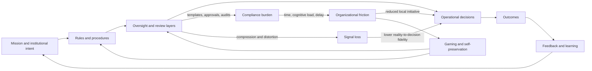
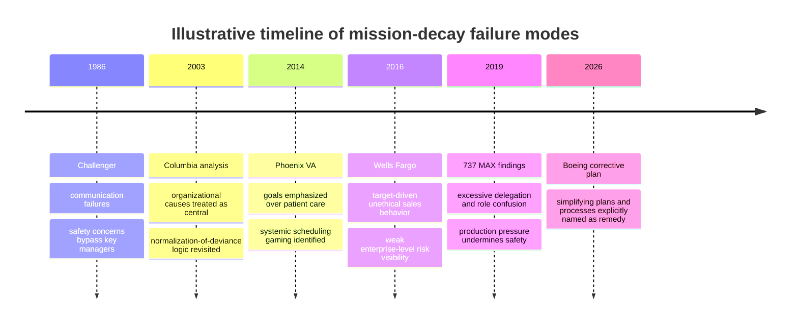

# Procedural Complexity, Oversight Layers, and the Decay of Institutional Intent

## Executive summary

We are tracing the inevitable decay of institutional intent as procedural complexity increases, proving that every new layer of oversight accelerates systemic rot. By mapping organizational friction against thermodynamic laws, we demonstrate how bloated hierarchies prioritize self-preservation over core missions, ultimately transforming efficient frameworks into entropic traps that guarantee operational paralysis.

The strongest defensible version of the claim is **conditional, not absolute**: as organizations add procedural complexity and serial oversight layers, they often reduce the fidelity with which frontline reality reaches decision centers, raise coordination and compliance costs, and increase incentives to optimize for passing reviews rather than serving the underlying mission. Under those conditions, institutional intent decays into ritualized compliance, self-protection, and gaming. Classic organization theory anticipated this through goal displacement and ceremonial formalism, while cybernetics and information-processing theory explain why excess layers can reduce regulatory effectiveness when they degrade information quality or local discretion faster than they improve control. citeturn16search4turn34search3turn13search5turn15search8turn22search1

The empirical record supports this claim **most strongly for mission alignment, employee strain, reporting quality, and adaptive speed**, and more unevenly for aggregate performance. A recent meta-analysis found robust constraining and alienating effects of red tape, but only a weak average direct relationship with organizational performance, implying that the real damage often appears first in morale, learning, and problem-detection rather than in short-run top-line outcomes. Experimental and observational work also shows that red tape increases burnout, while enabling rather than coercive control designs reduce perceived burden and improve procedural quality. citeturn18search0turn18search7turn38search5turn38search3

The best case studies are not merely “bureaucracy is bad” stories. They show a specific failure mode: **formal oversight exists, but its structure and incentives distort sensing and response**. The Rogers Commission found “failures in communication” and a management structure that allowed internal flight-safety problems to bypass key Shuttle managers prior to Challenger. The VA OIG found that Phoenix VA culture emphasized goals at the expense of patient care and that inappropriate scheduling “gaming strategies” were systemic nationwide. The House 737 MAX investigation found excessive FAA delegation, role confusion, and production pressure that moved both Boeing and the FAA away from their safety missions. Wells Fargo’s own board report found a decentralized risk structure that impeded corporate-level insight while sales targets drove unethical behavior. Urban Institute survey evidence shows that heavy reporting and application burdens divert nonprofit capacity away from mission delivery. citeturn25view1turn25view0turn30view4turn30view2turn31view1turn31view4turn25view7turn25view6turn26view0turn26view2

A rigorous synthesis therefore suggests an **inverted-U relationship**. Some formalization and independent oversight are beneficial, especially in high-hazard, high-fraud, or high-stakes settings. But once additional layers mostly add delay, compression, and coordination loss rather than genuine error detection, organizations enter an entropic regime in which effort is increasingly dissipated internally. The practical implication is not “abolish oversight,” but **design oversight to be enabling, risk-tiered, mission-linked, and information-preserving**. citeturn38search1turn38search3turn38search5turn9search4turn9search3

## Definitions and unstated assumptions

The term **institutional intent** is not a settled canonical term in organization science, so this report uses it as an analytical construct derived from the literature on **strategic intent**, mission, and mission drift. Operationally, it means the durable, shared specification of what outcomes the organization exists to produce, for whom, and how tradeoffs should be resolved when constraints bind. Strategic-intent research treats such an orientation as a long-run, performance-relevant guide to resource allocation and organizational direction. citeturn37search1turn37search12

**Procedural complexity** means the size and branching structure of the rule-and-process landscape through which work must pass: the number of rules, approval steps, handoffs, exceptions, reporting obligations, and process variants. In process analytics, relevant dimensions include model size, control-flow complexity, and structuredness; in public administration, the closest native concept is red tape, defined as rules, regulations, and procedures that remain in force, impose compliance burden, and do not advance legitimate purposes. citeturn12search1turn12search3turn16search0turn16search6

An **oversight layer** is an additional serial review tier between action and authorization: board committee, regulatory review, internal audit checkpoint, management approval gate, or reporting interface that must be satisfied before work proceeds or is judged acceptable. Research on firm hierarchies treats organizations as layered systems of knowledge and authority; managers at higher layers solve problems escalated from lower layers but also consume time and introduce coordination requirements. citeturn9search3turn9search4turn9search14

**Systemic rot** is also an analytic rather than canonical term here. It refers to a persistent pattern of degraded mission alignment, normalized data distortion, reduced corrective learning, slower response, and increased self-preservation behavior. This maps onto older ideas of **goal displacement** and newer institutionalist arguments that organizations can maintain formal structures ceremonially even when those structures decouple from substantive purpose. citeturn16search4turn34search3

**Organizational friction** means the time tax and cognitive burden created by interacting with the organization’s own controls. The administrative-burden literature decomposes burden into learning costs, compliance costs, and psychological costs; this framework is especially useful because it captures not only elapsed time but also stress, uncertainty, and loss of autonomy. citeturn11search0turn11search2turn11search3turn11search9

Several unstated assumptions are worth making explicit. The claim assumes that mission exists in a reasonably coherent form; that added controls are at least partly serial rather than purely parallel; that local actors possess information valuable to the mission; and that the marginal informational and motivational costs of additional review can exceed the marginal control benefit. It also assumes a distinction between **good oversight** and **ceremonial or coercive oversight**. Those assumptions often hold, but not always. High-hazard systems may require substantial redundancy, and some formalization improves quality and reliability rather than degrading them. citeturn38search1turn38search3turn38search5turn35search1

## Theoretical frameworks

Classic organizational theory treats bureaucracy as a double-edged technology. It can create predictability and accountability, but it also tends toward situations in which means become ends. Merton’s long-standing diagnosis of bureaucratic goal displacement remains relevant, and neo-institutional theory later argued that formal structures can survive as “myth and ceremony” even when loosely coupled to actual work. Those theories fit the present claim because they explain how control apparatus can gradually become self-justifying. citeturn16search4turn34search3

Organization design and information-processing theory sharpen this intuition. Galbraith and the later information-processing tradition argue that organizational structure should match the organization’s information-processing demands to its information-processing capacity. In simple, stable environments, more mechanistic forms can work. In uncertain, interdependent environments, heavy centralization and formalization often become maladaptive because they reduce the speed and richness of information flow needed for effective action. Contemporary reviews continue to frame organizations as information-processing systems whose designs must match task uncertainty. citeturn13search2turn13search5turn10search10

The hierarchy literature adds another nuance that matters for this question: layers are not inherently pathological. Formal models and matched employer-employee data show that firms often add managerial layers when they grow, export, or confront more complex problems; layers can raise knowledge capacity and specialization. But those same models also imply costs from additional escalation, monitoring, and coordination. This is why the most plausible theory is nonlinear: layers help until they no longer pay for themselves informationally. citeturn9search4turn9search14turn9search23turn9search3

Cybernetics gives the clearest control-theoretic language. Ashby’s law of requisite variety says that effective regulation requires enough regulator variety to match the variety of the system or environment being regulated. The “good regulator” theorem similarly holds that a good regulator must embody a model of the system it regulates. For organizations, this means two things. First, controls must preserve enough detail about operational reality to regulate it. Second, if added oversight destroys local variety or compresses the signal too aggressively, then control can worsen even while supervision visibly increases. citeturn15search8turn15search2turn35search1turn35search5turn14search4

Information theory offers a formal vocabulary for this degradation. Shannon’s framework treats communication as transmission through potentially noisy channels. Applied analogically to organizations, each approval or reporting layer is a potential lossy transformation: it can compress case-specific detail into standardized categories, induce omission of inconvenient information, or alter messages to fit template expectations. The relevant institutional quantity is not “more reports,” but the mutual information between frontline conditions and final decisions. If depth rises while signal quality falls, mission fidelity decays. citeturn22search1turn21search20

The thermodynamics analogy is useful if handled carefully. It should be treated as an analogy disciplined by information theory, not as a literal identity. Landauer-related work links information erasure and irreversible processing to dissipation in physical systems; nonequilibrium thermodynamics and dissipative-structure theory show how open systems maintain order only by importing energy and exporting entropy. For organizations, the clean takeaway is that control work consumes scarce energy in the form of time, attention, and cognitive effort. Rework, waiting, duplication, exception handling, and ceremonial reporting are forms of institutional dissipation. The analogy is strongest when describing **resource loss from irreversible internal processing**, and weakest when treated as literal physical entropy. citeturn23search5turn23search11turn23search13turn36search5turn36search16turn21search17

The core mechanism proposed by these frameworks is therefore straightforward: **serial oversight can improve reliability when it adds independent error detection, but it accelerates rot when it primarily converts substantive uncertainty into administrative burden, signal loss, and goal displacement**. citeturn25view0turn30view4turn31view1turn38search5

## Empirical evidence across sectors

Broad empirical work supports the existence of harmful friction, but also shows heterogeneity. The meta-analysis by George, Pandey, Steijn, Decramer, and Audenaert reports consistent negative effects of red tape on employee outcomes and weaker average direct effects on overall organizational performance, a pattern that fits the idea that decay often begins in morale, cognition, and adaptive capacity before it appears in lagged performance metrics. Related work finds that red tape raises burnout risks. At the same time, studies of enabling controls and some forms of formalization show that well-designed rules can improve procedural fairness and quality rather than acting as pure drag. citeturn18search0turn18search7turn38search5turn38search1

The most revealing evidence comes from case studies where mission failure was not caused by an absence of control, but by control architectures that distorted information, incentivized gaming, or subordinated mission to compliance and target attainment. The table below compares representative cases.

| Sector | Case | Added complexity or oversight mechanism | Observed decay mode | Core evidence | What it shows |
|---|---|---|---|---|---|
| Public | NASA Challenger | Multi-stage Flight Readiness Review and hierarchical launch approval process | Safety concerns attenuated; incomplete and misleading information reached launch decision | The Rogers Commission found “failures in communication” and “a NASA management structure that permitted internal flight safety problems to bypass key Shuttle managers”; prior 18-page analysis had been reduced to a one-page chart in Level I review. citeturn25view1turn25view0turn25view2 | More review stages did not ensure better judgment when signal compression and authority structure filtered the crucial anomaly. |
| Public | VA Phoenix and wider VHA | Wait-time targets, scheduling rules, EWL/NEAR list administration, centralized reporting | Goal displacement, manipulation of performance data, patient access delayed | VA OIG found the culture emphasized goals at the expense of patient care, identified inappropriate scheduling “gaming strategies,” and concluded such practices were systemic nationwide; nearly 1,700 veterans were on a local list for over 30 days without being on the official electronic wait list. citeturn30view2turn30view4turn30view5turn27view0 | Oversight metrics can induce self-protective reporting behavior when local career incentives attach more strongly to measured access than actual access. |
| Private | Boeing 737 MAX | Extensive delegated certification, multiple interfaces between Boeing ARs and FAA, internal compliance and review procedures under schedule pressure | Safety mission drift, role confusion, impaired independent challenge | The House report found excessive FAA delegation eroded oversight effectiveness, FAA role confusion moved the agency away from its safety mission, and production pressures undermined safety; 39% of Boeing ARs reported undue pressure. citeturn31view1turn31view2turn31view4turn31view0 | Oversight quantity is not oversight quality; delegated and layered review can fail when independence and mission clarity are weak. |
| Private | Wells Fargo sales practices | Multiple lines of defense and board oversight, but decentralized risk structure and target-heavy management | Ethical decay, self-preservation, local gaming, weak enterprise visibility | Wells Fargo’s independent directors found that decentralization impeded corporate-level insight into Community Bank risks, while HR-linked sales goals were driving unethical behavior; later SEC action noted the firm reorganized to centralize control functions. citeturn25view7turn25view6turn25view9 | Thinly connected oversight layers can coexist with low mission fidelity when incentives overrun control architecture. |
| Nonprofit | U.S. nonprofits with government contracts and grants | Heavy application/reporting requirements, inconsistent definitions, delayed payments, underpayment of indirect cost | Mission crowd-out, reserve depletion, staff and program cuts | The Urban Institute found that more than 70% of nonprofits reported complex applications and reporting as problematic; those reporting burdens were significantly more likely to draw on reserves, reduce employees, and reduce programs or services. The report explicitly concluded that streamlining would let nonprofits focus more on shared public-service missions. citeturn26view2turn26view0 | Administrative burden can crowd out mission execution even without scandal or formal failure. |
| Hybrid nonprofit-social finance | Latin American microfinance transformation | Commercialization, formal finance linkages, stronger financial discipline and reporting | Potential mission drift toward less-poor clients, but not uniformly | World Bank/CGAP documented debate over whether commercialization drives institutions up-market, but also concluded transformation does not necessarily force microfinance institutions up-market and that larger loans do not automatically indicate mission drift. citeturn24view6turn25view12turn25view13 | Boundary condition: stronger controls and commercial discipline can alter mission, but drift is not inevitable; context and original target population matter. |

These cases point to three recurring empirical mechanisms. The first is **signal attenuation**: frontline anomalies become summary slides, category codes, or averaged indicators before reaching authority. Challenger is the purest example. citeturn25view2turn25view1

The second is **goal displacement through target optimization**. In Phoenix VA, measured wait-time performance became more salient than actual access; in Wells Fargo, tied performance metrics drove unethical cross-selling; in both cases, mission language remained intact while operational behavior shifted toward “passing the metric.” citeturn30view2turn30view4turn25view6

The third is **oversight decoupling**: organizations accumulate review bodies and compliance routines that look like control but fail to improve substantive regulation because authority is fragmented, local incentives conflict with mission, or reviewers lack independence. The 737 MAX case is strong on this point, and the nonprofit contracting evidence shows a less catastrophic but structurally similar pattern in which compliance tasks absorb resources without proportional public-value gain. citeturn31view1turn31view3turn26view0turn26view2

The counterevidence matters. Some hierarchy is productive, especially when it expands knowledge capacity, and some formalization improves service quality or fairness. Recent work on enabling versus coercive control systems also shows that design matters sharply. The claim is therefore best treated as a statement about **excessive or misdesigned** complexity, not about all procedures per se. citeturn9search4turn9search3turn38search1turn38search5turn38search8

## Quantitative measures and formal models

A useful measurement program should distinguish five latent constructs: procedural complexity, oversight depth, friction, intent fidelity, and performance decline. The table below gives practical metrics, how to compute them, and what data sources to use.

| Construct | Candidate metric | Measurement method | Likely data sources |
|---|---|---|---|
| Procedural complexity | Rule count; process-control-flow complexity; number of exceptions; documentation minutes per case | Count active procedures and required forms; compute process graph size and branching from event logs; estimate time-on-administration from activity logs or time-use surveys | Policy manuals; BPMN/process maps; ERP/CRM/ticketing logs; workflow tools; internal time-allocation surveys; process-mining event logs with case ID, activity, timestamp. citeturn12search1turn12search3turn12search20turn11search12 |
| Oversight depth | Mean approval-chain length; max escalation depth; review-body count per decision class | Build a directed authority graph from approval logs and org charts; compute shortest and longest required paths by decision type | IAM/approval systems; e-signature logs; org charts; governance charters; board and committee calendars. citeturn9search3turn9search14 |
| Organizational friction | Queue time; handoffs; reopen/rework rate; overdue percentage; administrative burden index | Estimate cycle-time decomposition into value-added vs waiting; count handoffs; survey learning/compliance/psychological costs | Workflow timestamps; service desks; email/calendar metadata; employee surveys using administrative-burden items. citeturn11search2turn11search4turn11search14 |
| Intent fidelity | Budget-to-mission alignment; exception handling for mission-critical cases; semantic similarity between mission and portfolio | Map strategy documents to budget/program allocations; use NLP to compare mission statements with project descriptions; audit exceptions granted for mission-critical reasons | Strategic plans; budget records; procurement data; grant/program descriptions; board minutes; portfolio databases. citeturn37search1turn37search12 |
| Performance decline | Service timeliness, error rates, safety incidents, beneficiary coverage, innovation throughput, burnout/turnover | Sector-specific KPI panel with pre/post reorganization trend analysis; combine operational and human factors | Public-service dashboards, incident systems, HRIS, customer/beneficiary data, audit reports. citeturn18search7turn20search2 |
| Rot indicators | Data manipulation findings; repeated audit exceptions; whistleblower load; growth of reporting work relative to delivery work | Create a standardized “rot index” from audit recurrence, adverse findings, metric restatements, and ratio of reporting FTE to delivery FTE | OIG/GAO reports; internal audit logs; SEC enforcement records; HR and ethics hotlines. citeturn30view4turn31view1turn24view1 |

For public organizations, strong external datasets include procurement and administrative-system data, official performance dashboards, and audit bodies. Federal Procurement Data System data are available through Data.gov, and OECD’s *Government at a Glance* provides comparative indicators on government practices, procedures, and outcomes. For nonprofits, the IRS provides bulk XML downloads for Form 990 series filings, which can be linked to mission statements, program-service ratios, and changes in overhead or staffing. For private firms, the best evidence usually comes from internal process logs, but external benchmarks exist in linked employer-employee datasets and recent work inferring hierarchy from labor-market data. citeturn20search1turn20search2turn19search0turn19search15turn19search10turn9search0

A practical field design should combine **process mining**, **text analysis**, and **organizational network analysis**. Process mining is particularly attractive because it turns raw event logs into discovered real processes and supplies metrics such as fitness, precision, and structural appropriateness. It can quantify where procedures branch, where cases wait, and where exceptions proliferate. This is far superior to relying only on formal process maps, which often describe intended rather than actual work. citeturn12search3turn12search4turn12search21

The following synthesized metrics are especially useful:

| Symbol | Definition | Interpretation |
|---|---|---|
| \(C\) | Procedural complexity index, e.g. \(C = \log(1+N_{rules}) + \lambda_1 CFC + \lambda_2 E + \lambda_3 H\) | Higher when active rules, branching, exception frequency \(E\), and handoffs \(H\) rise |
| \(L\) | Mean oversight depth | Expected number of serial review layers per case |
| \(F\) | Friction index, e.g. standardized combination of waiting share, admin time share, reopen rate, and burden survey scores | Direct measure of internal dissipation |
| \(I\) | Intent fidelity index, e.g. cosine similarity of mission-to-budget taxonomy plus exception alignment score | Higher when resources and decisions track mission rather than proxy targets |
| \(R\) | Rot stock | Rising stock of recurring audit findings, gaming incidents, and mission-decoupled behavior |
| \(P\) | Performance | Sector-specific mission outcome, not merely compliance or throughput |

A workable collection protocol is to extract one year of case-level workflow logs, map decision types to mission categories, reconstruct actual approval graphs, survey staff on administrative burden, and link these to outcome data. In nonprofits, add IRS 990 data and funder-reporting burden. In public bodies, link to procurement, audit, and service-delivery records. In firms, use ERP, issue-tracking, and quality-control systems, plus hierarchy information. citeturn19search0turn20search1turn12search20turn19search10

Formal modeling clarifies the mechanism. Let \(M(L)\) be the mission-relevant information preserved after \(L\) serial oversight layers. If each layer loses a fraction \(\varepsilon_i\) of relevant information, then

\[
M(L)=M_0\prod_{i=1}^{L}(1-\varepsilon_i)
\]

and under homogeneous loss \(\varepsilon\),

\[
M(L)=M_0(1-\varepsilon)^L \approx M_0 e^{-\varepsilon L}.
\]

This is an organizational analogue of noisy transmission: more layers are harmless only if \(\varepsilon\) is very small or if later layers add genuinely independent information. citeturn22search1turn13search5turn15search8

Let friction rise with both direct review time and coordination among layers:

\[
F(L)=f_0+\alpha L+\beta \frac{L(L-1)}{2}+\gamma E
\]

where \(\alpha\) is per-layer direct cost, \(\beta\) is cross-layer coordination overhead, and \(E\) is exception intensity. The quadratic term reflects the fact that the headache usually comes not from the mere existence of a new reviewer, but from the interfaces among reviewers. This structure is consistent with process-complexity and hierarchy models in which coordination costs grow with branching and escalation. citeturn12search1turn9search3turn9search4

A compact performance function that captures both the benefits and costs of oversight is

\[
P(L)=P_0(1+uL)e^{-vL-wL^2},
\]

where \(u\) is the early-stage control benefit from added review, \(v\) is linear friction cost, and \(w\) is the escalating interaction cost from added interfaces. This yields an interior optimum only when the early marginal benefit of oversight exceeds its early marginal cost. If \(u \leq v\), more layers are harmful from the start. If \(u > v\), performance first rises and then falls as the quadratic dissipation term dominates. This is the formal version of the “oversight inverted-U.” citeturn9search4turn38search1turn38search5

A rot-dynamics equation is also useful:

\[
\frac{dR}{dt}=\theta F+\phi G-\psi A,
\]

where \(R\) is rot stock, \(F\) is friction, \(G\) is gaming/goal displacement frequency, and \(A\) is adaptive repair capacity, meaning simplification, learning, whistleblowing efficacy, and mission-driven exception handling. Rot accelerates when friction and gaming outpace organizational repair. This captures why some institutions decline gradually and then suddenly: \(R\) is a stock variable with delayed visibility. The first symptoms often appear in surveys, incident reports, or exception logs before they appear in headline metrics. citeturn18search7turn30view4turn26view2

Sensitivity analysis follows directly. The most consequential parameters are usually \(\varepsilon\), \(\beta\), and \(E\). Small increases in per-layer information loss or cross-layer coordination overhead can sharply reduce performance in uncertain environments. By contrast, in stable, repetitive, low-variance environments, \(u\) can be relatively large and \(w\) relatively small, so the efficient number of layers rises. High-hazard systems require some redundancy and verification, but they are also unusually sensitive to information loss, which is why “more review” can still degrade safety if it suppresses dissent or compresses anomalies. citeturn25view0turn31view1turn35search1

## Causal inference, design implications, limitations, and ethics

The central causal problem is reverse causality. Organizations often add procedures and oversight **because** they are already failing, growing, or facing higher risk. A raw correlation between more layers and worse outcomes therefore does not prove that layers caused decline. Stronger designs include difference-in-differences around exogenous reorganizations, regression discontinuity around thresholds that trigger extra approvals or audits, event studies around staggered reporting reforms, and process-level randomized simplification experiments. A useful empirical exemplar is the Indian banking study that exploited exogenous variation in organizational hierarchy induced by a reorganization and used a difference-in-differences design to study information production. citeturn9search9

The main confounders are growth, environmental turbulence, regulation, product risk, staffing shortages, digital immaturity, political interference, and incentive schemes. Understaffed organizations often add procedure as a substitute for judgment; heavily regulated organizations often face exogenous compliance mandates; mission drift can be driven by commercialization or donor/funder pressure rather than by internal oversight depth as such. The microfinance literature is a good reminder that mission drift is neither automatic nor monocausal. citeturn25view13turn25view12turn17search1

The practical design lesson is to treat oversight as a scarce information-processing resource, not as a free moral good. review should be concentrated where downside risk is catastrophic or fraud incentives are strong, while routine, low-variance decisions should be simplified, automated, or delegated. A serial approval that adds no new information should usually be removed. This recommendation aligns with both the hierarchy literature and cybernetic arguments for matching control variety to environmental complexity. citeturn9search3turn15search8turn35search1

Rules themselves should be designed as **enabling** rather than coercive. The relevant contrast is not rules versus no rules, but rules that help workers solve problems versus rules that exist mainly to enforce ritual compliance. Research on enabling control systems and green tape suggests that procedural quality improves when employees understand the rationale, can use rules as organizational memory, and face less coercive performance measurement. citeturn38search5turn38search16turn38search0turn38search9

Organizations should also preserve **frontline variety**. In cybernetic terms, local units need room to absorb local variance rather than escalate every exception up a narrow vertical channel. In governance terms, this means risk-tiered delegation, mission-bound discretion, and exception pathways that reward truthful escalation rather than punishing it. Polycentric or semi-autonomous units can outperform thick central review when local conditions are diverse and time-sensitive. citeturn35search1turn15search8

A concrete anti-rot program usually has six elements: periodic deletion or sunset of approvals and reports; transparent mapping from mission to budgets and metrics; independent channels for safety, ethics, and beneficiary impact; process-mining dashboards focused on waiting, rework, and exception loads; harmonization of overlapping funder or regulator requirements; and post-audit learning loops that fix root causes rather than merely add new controls. Notably, Boeing’s current corrective plan explicitly lists “simplifying plans and processes” as one of its major improvement areas, which is a contemporary corporate acknowledgment of the underlying mechanism. citeturn6search2turn6search6turn26view0

The ethical risks run in both directions. Under-controlled organizations can harm the public through negligence, bias, or corruption. Over-controlled organizations can deny services, suppress truth, exhaust workers, and privilege procedural defensibility over real beneficiaries. Simplification is therefore not ethically neutral; removing controls in safety-critical, equity-sensitive, or fiduciary domains can be reckless. The correct ethical criterion is not minimal bureaucracy, but the **lightest control architecture that preserves accountability, truthfulness, and mission protection**. citeturn25view0turn30view4turn18search7

The largest conceptual limitation is the entropy analogy itself. Physical entropy and thermodynamic dissipation are precise physical quantities; institutional “entropy” is metaphorical unless one explicitly operationalizes it using information-theoretic or process metrics. A second limitation is observability: organizations can appear healthy while rot accumulates in unmeasured waiting, escalation, and self-censorship. A third is that any quantitative measure of mission alignment can itself become a target and invite gaming. That is why the report’s recommended metrics should be used as diagnostic instruments, not as standalone command targets. citeturn23search5turn21search17turn18search0turn30view4

## Prioritized sources

The sources below are the highest-value starting set for further work because they jointly cover theory, measurement, and official case evidence.

| Priority | Source | Why it matters |
|---|---|---|
| High | Rogers Commission, *Report of the Presidential Commission on the Space Shuttle Challenger Accident* | Canonical official study of layered review, communication failure, and safety signal attenuation. citeturn25view1turn25view0 |
| High | VA OIG, *Review of Alleged Patient Deaths, Patient Wait Times, and Scheduling Practices at the Phoenix VA Health Care System* | Official evidence of target distortion, gaming strategies, and systemic mission drift in a public service system. citeturn30view4turn30view2 |
| High | U.S. House T&I Committee, *Final Committee Report on the Design, Development, and Certification of the Boeing 737 MAX* | Rich official account of production pressure, excessive delegation, role confusion, and safety-mission erosion. citeturn31view1turn31view4 |
| High | Wells Fargo Independent Directors’ Report and SEC 2020 order | Strong corporate-governance evidence on target-driven unethical behavior and weak control architecture. citeturn25view7turn25view6turn25view9 |
| High | Urban Institute, *Nonprofit-Government Contracts and Grants* | Best concise evidence that administrative burden directly crowds out nonprofit mission capacity. citeturn26view0turn26view2 |
| High | George et al., meta-analysis on red tape | Best broad synthesis of what heavy procedural burden does and does not reliably predict. citeturn18search0 |
| High | Shannon, *A Mathematical Theory of Communication* | Formal base for treating organizational layers as potentially lossy communication channels. citeturn22search1 |
| High | Galbraith and later information-processing reviews | Core organization-design framework for matching structure to information-processing demand. citeturn13search2turn13search5 |
| High | Ashby and good-regulator lineage | Best cybernetic explanation for why overcentralized or information-destroying oversight can fail. citeturn15search8turn14search4 |
| High | Hierarchy and productivity studies by Garicano/Caliendo/Gumpert and related work | Essential boundary condition showing layers can be productive before they become excessive. citeturn9search4turn9search3turn9search14 |

Taken together, the evidence supports a rigorous but qualified conclusion: **increasing procedural complexity and serial oversight layers can indeed decay institutional intent and accelerate systemic rot, but mainly when those layers degrade information fidelity, raise friction, and incentivize target-passing over mission-serving.** The correct general law is not “more oversight causes rot.” It is closer to this: **oversight beyond the point of informational and motivational usefulness becomes internally dissipative, and once dissipation outruns learning, organizations begin to preserve procedures more faithfully than purposes.** citeturn31view1turn30view4turn26view0turn18search0turn38search5
